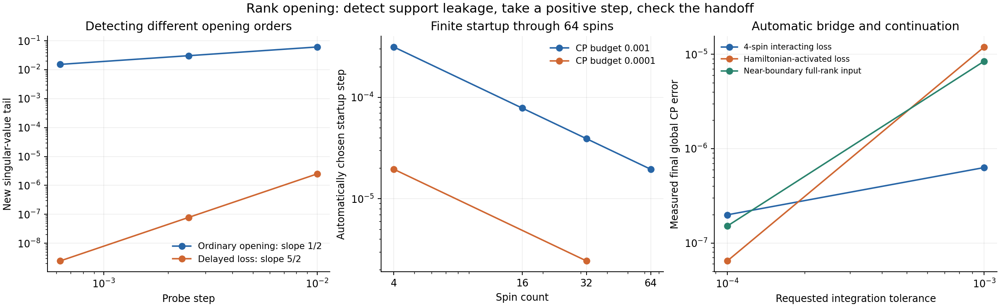

# Automatic rank-opening detection and positive canonical-purification steps

November 6, 2026.

There is now an implemented automatic detector and handler. The detector uses **noise leakage outside the current density support**, rather than a failed Sylvester solve or the rank of local marginals. The handler takes a finite positive step and computes its canonical root from Kraus factors. A small-system hybrid switches back to ordinary square-root-time evolution afterward. An MPS implementation performs automatically budgeted startup steps through 64 spins. Its handoff audit correctly detects that truncating the jump expansion can leave further rank opening to handle.



**The detector.** Let Q=√ρ, P be the support projector of ρ, and R=I−P. For a Lindblad generator,

$$
B=R\mathcal L(\rho)R
 =\sum_\mu (RL_\mu Q)(RL_\mu Q)^\dagger\ge0.
$$

The Hamiltonian and anticommutator terms vanish in this block. Thus

$$
\beta=\operatorname{Tr}B=\sum_\mu\|RL_\mu Q\|_F^2
$$

detects first-order population entering the kernel. When β>0,

$$
\sqrt{\rho(t+h)}=Q+\sqrt h\,\sqrt B+O(h),
\qquad \|\sqrt h\sqrt B\|_F=\sqrt{h\beta}.
$$

This identifies both the missing CP direction and its leading magnitude. Setting kernel denominators to zero in the Sylvester equation would discard this term. Changing the clock to u=√(t−t_event) makes the leading derivative finite, but does not create a missing direction in the tensor representation. Singular square-root perturbations are discussed more generally by [Carlsson](https://arxiv.org/abs/1810.01464). Adaptive density-rank methods also use leakage/error estimates to enlarge support; see [Le Bris, Rouchon and Roussel](https://cas.minesparis.psl.eu/~rouchon/publications/PR2015/PhysRevA.92.062126.pdf). The present target is the canonical square root and its CP error.

For a pure state, no global eigendecomposition is needed:

$$
\beta=\sum_\mu\left(\langle L_\mu^\dagger L_\mu\rangle-
 |\langle L_\mu\rangle|^2\right).
$$

The code evaluates the norms of the residual vectors (Lμ−⟨Lμ⟩)|ψ⟩ directly, avoiding subtraction of two nearly equal expectation values. It first audits Q²≈Q and extracts a ket MPS by conditioning reference spins, with normalization at every site. This works for entangled pure inputs even when their one-site marginals are full rank.

For a supplied mixed-state factor ρ=ZZ†, whose columns are MPSs, the implementation also computes support leakage without a dense physical matrix. Set G=Z†Z and Mμ=Z†LμZ. Then

$$
\beta=\frac{\sum_\mu\{\operatorname{Tr}(Z^\dagger L_\mu^\dagger L_\mu Z)
 -\operatorname{Tr}(M_\mu^\dagger G^+M_\mu)\}}{\operatorname{Tr}G}.
$$

The denominator normalizes the factor state. Pairwise MPS environments provide all one-site transition elements in a sweep. The dense matrices scale with the number of factor columns, not 2ᴺ. Conditioning and discarded numerical support mass are reported. The roundoff warning scale is a heuristic diagnostic, not interval arithmetic. For a general mixed MPO with no supplied support representation, efficient support detection remains unresolved; local marginals cannot replace the missing global support information.

**Distinguishing three situations.** The dense control backend classifies genuine first-order opening, full-rank near-boundary stiffness, and smooth evolution. The numerical root-support threshold is 10⁻¹² relative to the largest root eigenvalue, and its discarded density mass is reported. “Rank” in this implementation is therefore numerical rank, not an exact mathematical claim about arbitrarily small eigenvalues.

A nonzero but tiny population is treated differently from a kernel. A step-dependent exposure h|ρ̇ᵢᵢ|/ρᵢᵢ flags potentially large relative population changes. This is a stiffness heuristic. After initialization it reduces the ordinary step rather than declaring a new rank event. The actual step still undergoes an error check.

When β vanishes but the input is rank deficient, a positive finite-step probe checks whether additional root singular values appear. This is needed because Hamiltonian motion can activate later dissipation. The probe is a lookahead diagnostic, not a proof that all higher-order openings are excluded when it finds none. Step refinement remains necessary.

Nine detector tests pass:

| Input and dynamics | Automatic result |
|---|---|
| Four-spin plus product with interacting Ising Hamiltonian and loss | First-order opening |
| GHZ pure state with phase noise; one-site marginals full rank | First-order opening |
| Rank-two ferromagnetic mixture with bit flips | First-order opening |
| Same mixture with phase flips | No resolved opening |
| Loss-dark ground state, H=0 | No resolved opening |
| Pure state undergoing unitary support rotation | No resolved opening |
| Ground state, H=X, L=|0⟩⟨1| | Delayed opening |
| Maximally mixed input | Smooth |
| Full-rank input with population 10⁻⁸ under bit flips | Near-boundary stiffness |

The ordinary opening probe scales as h¹ᐟ². The Hamiltonian-activated loss example instead has a newborn root singular value proportional to h⁵ᐟ²: decreasing h by four changes the probe tail by approximately 32. Thus checking only a nonzero instantaneous √h coefficient is insufficient. This exponent concerns the new singular value; the total CP change also contains ordinary coherent motion.

**Performing the event.** In the general dense backend define S=ΣLμ†Lμ. For h||S||≤1,

$$
K_0=\sqrt{I-hS},\qquad K_\mu=\sqrt h L_\mu,
\qquad \sum_aK_a^\dagger K_a=I.
$$

Hamiltonian half steps surround this dissipative channel. Apply the resulting Kraus operators to Q and stack the factors:

$$
\mathcal Z_h=[\widetilde K_0Q,\widetilde K_1Q,\ldots]=U\Sigma V^\dagger,
\qquad Q_{\rm new}=U\Sigma U^\dagger.
$$

This produces the positive canonical root of the finite channel output. The √h amplitudes enter explicitly. Forming the density matrix first and cutting its small eigenvalues would lose more information than factor SVD. The dissipative step has first-order density accuracy; Hamiltonian half steps do not make it a second-order dissipative method.

The handler compares one step with two half steps, shrinks the interval as necessary, and accepts the two-half-step result. Across a rank-changing boundary it uses their CP difference directly, without dividing by three. This is a numerical error estimator, not a rigorous global error certificate. Smooth steps use square-root-time midpoint integration with step doubling. The dense control uses the full tangent space and an exact polar retraction; it is not a new restricted-bond TDVP validation.

For the four-spin interacting-loss model, evolution to t=0.03 gives:

| Requested tolerance | Positive bridge steps | Smooth steps | Final global CP error |
|---:|---:|---:|---:|
| 10⁻³ | 1 | 107 | 6.30 × 10⁻⁷ |
| 10⁻⁴ | 1 | 171 | 1.99 × 10⁻⁷ |

The finer run automatically chooses an initial physical step of 1.953125 × 10⁻⁵. For the Hamiltonian-activated loss and near-boundary full-rank tests, the finer-run final errors are 6.45 × 10⁻⁸ and 1.51 × 10⁻⁷. References are independent dense Lindblad exponentials. All final roots are positive. Accumulated step estimates and the full event histories are saved; a requested tolerance is not advertised as a proved total-error bound.

**The large-system finite startup.** The MPS backend currently implements the interacting model from the previous study:

$$
H=.7\sum Z_jZ_{j+1}+.43\sum X_j+.19\sum Z_j,
\quad L_j=\sqrt{.3+.12\cos^2j}\,\sigma^-_j.
$$

Let G_eff=−iH−ΣLμ†Lμ/2 and V(s)=exp(sG_eff). A positive approximation retains the no-jump trajectory and midpoint approximations to the one-jump trajectories:

$$
z_0=V(h)|\psi\rangle,\qquad
z_\mu=\sqrt h\,V(h/2)L_\mu V(h/2)|\psi\rangle.
$$

All columns are MPSs. Contractive Lie products approximate V using onsite factors and ZZ gates. The factor state is positive but not exactly trace preserving; its canonical root is normalized explicitly. The old no-jump direction is removed before diagonalizing the innovation Gram matrix. This keeps the order-one population out of the small-eigenvalue calculation. A small SVD then produces the canonical root as a sum of positive dyads, followed by controlled MPO rounding. The code retains root-scale information and reports every truncation contribution.

The step is chosen automatically from a conservative analytic error budget. Define Λ=Σ||Lμ||², C²=Σ||[Lμ,G_eff]||², and C_AB≥||[A,B]|| for the onsite/ZZ split G_eff=A+B. In exact arithmetic, a purification error bound for the uncompressed trajectory approximation is

$$
e(h)\le
\sqrt{\tfrac12(\Lambda h)^2+\tfrac1{12}h^3C^2}
+\sqrt{(h^2C_{AB}/2)^2+h\Lambda(h^2C_{AB}/4)^2}.
$$

The first term bounds omitted trajectories with at least two jumps and midpoint quadrature of the one-jump amplitudes. The jump count is dominated by a Poisson process of rate Λ. The derivative of a one-jump amplitude is V(h−s)[Lμ,G_eff]V(s)|ψ⟩, giving the midpoint bound. The second term is the contraction-semigroup Lie-product error. Local commutator norms give explicit upper bounds for the constants.

Purification errors translate to CP-root errors using

$$
\|\sqrt{AA^\dagger}-\sqrt{BB^\dagger}\|_F
 \le\sqrt2\,\|A-B\|_F.
$$

One proof applies the Frobenius Lipschitz inequality for the absolute-value function on Hermitian matrices to the Hermitian dilations of A and B, then keeps the AA† block. Normalization, input reconstruction, discarded innovation modes, and tensor rounding are added separately. The reported bound excludes floating-point and small-Gram eigensolver errors; it is not a computer-assisted interval certificate. Dense checks verify the root construction and the bound on small systems.

| Spins | Automatic h, CP budget 10⁻³ | Product-input bound | Cluster-input bound |
|---:|---:|---:|---:|
| 4 | 3.125 × 10⁻⁴ | 4.67 × 10⁻⁴ | 4.67 × 10⁻⁴ |
| 16 | 7.8125 × 10⁻⁵ | 4.51 × 10⁻⁴ | 4.51 × 10⁻⁴ |
| 32 | 3.90625 × 10⁻⁵ | 4.52 × 10⁻⁴ | 4.51 × 10⁻⁴ |
| 64 | 1.953125 × 10⁻⁵ | 4.53 × 10⁻⁴ | 4.51 × 10⁻⁴ |

The 64-spin startup uses state bond 16 and a 65-column trajectory factor. For four spins, measured CP errors are 7.13 × 10⁻⁵ for the product input and 1.19 × 10⁻⁴ for the cluster input. At a tighter 10⁻⁴ budget, those errors decrease to 4.45 × 10⁻⁶ and 7.45 × 10⁻⁶. Direct comparison with the canonical root of the retained Kraus factor agrees within 7.1 × 10⁻¹⁴. An intentionally undersized bond-2 cluster initialization automatically retries at larger bonds and succeeds at bond 8, with a bound of 2.82 × 10⁻⁵.

**The handoff is essential.** A root can be accurate to the startup budget while still being rank deficient. The one-jump truncation generally leaves missing multiple-jump sectors. At 32 spins the support audit detects further leakage rates 3.16 × 10⁻⁴ and 1.26 × 10⁻³ for the product and cluster startups, respectively. These are well above the reported conditioning/roundoff warning scales. At four spins the MPS-factor detector matches the dense kernel calculation to better than 10⁻¹⁵.

The public `automatic_startup` wrapper therefore runs the support audit by default. Its result is `rank_aware_continuation_required` when further opening is detected; it does not hand the state silently to the smooth MPO-force solver. Setting `check_handoff=False` is available for isolated startup measurements and explicitly returns `support_audit_required`. The support audit concerns the intended Kraus-factor state before final MPO rounding, so spurious tiny eigenvalues created by compression are not mistaken for correctly opened physical sectors.

The small-system backend already handles repeated events and returns to smooth evolution. The large-system backend establishes automatic detection, a positive finite startup, automatic step/bond selection, and a guarded handoff. It does **not** yet provide an efficient general mixed-MPO handler for every subsequent event. Retaining all global Kraus sectors can grow exponentially, while the CP MPO may still have small spatial bond. Physical density rank and MPS bond rank must therefore remain separate. The current global startup bound also selects h of order 1/N at fixed total CP budget. A fixed-buffer or thermodynamic-limit implementation still needs a local error budget and a way to handle subsequent opening without enumerating global jump sectors.

**Files and reproduction.** Python, NumPy, SciPy, and Matplotlib are the only dependencies. No dense whole-chain matrix is used in the large MPS startup or factor-support audit. The dense routines are explicit control experiments. CSVs and saved startup MPOs are in `automatic_rank_results/`.

```text
python test_automatic_rank_opening.py
python test_rank_opening_mps.py --n 4 16 32 64
python test_rank_opening_mps.py --n 4 32 --budget .0001
python audit_rank_handoff.py --n 4 16 32
python plot_automatic_rank.py
```

Entry points: `automatic_rank_opening.automatic_step` and `.evolve` for dense controls; `rank_opening_mps.automatic_startup` for a guarded pure-MPO startup; `rank_opening_mps.detect_factor_support` for a supplied mixed MPS factor. A failed force solve on its own never proves rank opening.
