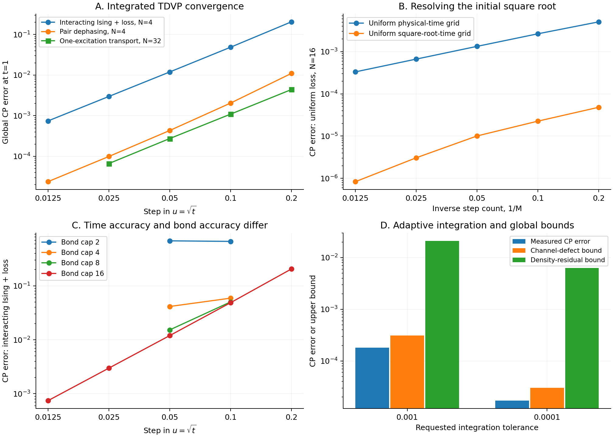

# Canonical-purification TDVP with square-root-time startup

November 4, 2026.

This implementation evolves the canonical-purification MPS by projecting a force calculated from the **current numerical state**. It includes unrestricted one-site and two-site tensor variations, a finite positive startup for rank opening, square-root-time integration, bond truncation, optional polar branch correction, adaptive time steps, and two global error checks. It does not fit a spatial unitary and does not use the exact future CP as an evolution target.

There are two force backends. The generic Lindblad backend currently uses dense matrices and is tested on four- and five-spin interacting systems. A structured one-excitation backend is tested through 512 sites. Thus the TDVP equations and integration procedure are implemented, but a generally efficient, manifestly local force and branch solver for thermodynamic systems is **not established**.



## 1. The dynamical target

Let $X=\sqrt\rho\ge0$, normalized by $\mathop{\mathrm{Tr}}\nolimits X^2=1$, and vectorize it as an MPS with local dimension four, pairing physical and reference spins. On a smooth path,

$$
\mathcal S_X(\dot X):=X\dot X+\dot X X=\mathcal L(X^2).
$$

For positive definite X, the force is uniquely

$$
F(X)=\mathcal S_X^{-1}[\mathcal L(X^2)],\qquad
F_{ab}=\frac{[U^\dagger\mathcal L(X^2)U]_{ab}}{x_a+x_b}
$$

in an eigenbasis $X=U\mathop{\mathrm{diag}}\nolimits (x_a)U^\dagger$. On a constant-rank path the compatible support solution is used; a nonzero kernel-kernel forcing block indicates rank opening and cannot be discarded as though an ordinary derivative existed.

The CP-vector TDVP target is

$$
\dot\Psi=P_{T_\Psi\mathcal M_\chi}\mathop{\mathrm{vec}}\nolimits F(X),
\qquad
\min_{\dot\Psi\in T_\Psi\mathcal M_\chi}
\|\dot\Psi-\mathop{\mathrm{vec}}\nolimits F(X)\|_2^2.
$$

The normalization direction is removed numerically. This is the standard tangent-space construction applied to the nonlinear CP force. We use the MPS projector structure from [Haegeman et al., 2011](https://arxiv.org/abs/1103.0936) and [Haegeman et al., 2016](https://arxiv.org/abs/1408.5056). Our time integrator is a retracted explicit midpoint method, not the projector-splitting integrator of the latter paper.

An inner numerical solver for the Sylvester equation could minimize its linear residual, but that inner solve must approximate F before the CP-vector TDVP projection. Minimizing a projected density/Sylvester residual directly is a differently weighted dynamical objective; it is not silently substituted here.

For an approximate amplitude A that is slightly off the canonical branch, the dense force provider uses $\rho_A=AA^\dagger$, $X_A=\sqrt{\rho_A}$, and $F(X_A)$. This defines the implemented extension away from the canonical manifold. Branch defects are measured and optionally corrected. It agrees with the intended force when A is canonical; its suitability far from that branch is not assumed.

## 2. Deriving the square-root onset

Let $P=\mathop{\mathrm{supp}}\nolimits \rho_0$, $Q=I-P$, and $G=\mathcal L(\rho_0)$. The kernel block is positive:

$$
QGQ=\sum_\mu QL_\mu\rho_0L_\mu^\dagger Q\ge0.
$$

Hamiltonian and anticommutator terms vanish in this block. Expanding in $u=\sqrt t$,

$$
\boxed{X(t)=X_0+\sqrt t\,K+O(t),\qquad K=\sqrt{QGQ},}
$$

where K acts on Q. Indeed, inserting $X=X_0+uK+u^2B+\cdots$ into $X^2=\rho_0+u^2G+\cdots$ gives $X_0K+KX_0=0$ and $QK^2Q=QGQ$. The positive square root fixes the leading branch. Higher jump sectors can first enter at higher powers of u.

For u>0 the force becomes

$$
\frac{dX}{du}=2u\,\mathcal S_X^{-1}[\mathcal L(X^2)].
$$

Its right-hand limit at u=0 along the physical trajectory is K. A bounded physical-time Hamiltonian is unnecessary. Merely setting the singular kernel denominators to zero would omit this new component.

The implementation uses a finite positive channel step at $t_{\rm seed}=u_{\rm seed}^2$, fits/compresses its positive root, and then runs TDVP in u. The channel step also permits the bond to acquire initially missing directions. It is a genuine part of the algorithm, rather than an exact-state oracle at a later time.

For the benchmark generators, the startup channel is a symmetric product of Hamiltonian half steps and exact dissipative channels. The dissipators commute within each supplied dissipative layer. A general collection of overlapping noncommuting dissipators would require its own positive symmetric splitting.

### A numerical issue that mattered

Computing a density matrix and then taking its square root can erase physically relevant small eigenvalues. At the four-spin Ising startup t=0.0025, the smallest root eigenvalue is about **5.35e-8**, whose squared density eigenvalue is about **2.86e-15**. A density-level cutoff of 1e-14 removed that population. This produced a false kernel and made an adaptive run stall.

The corrected startup carries a Kraus purification factor B:

$$
B\longmapsto[\,K_0B\;K_1B\;\cdots\,].
$$

Thin SVDs compress its redundant column space without squaring its singular values. If $B=U\Sigma V^\dagger$, the root is $U\Sigma U^\dagger$. The density agrees with the channel calculation to 2.2e-15 while the small root eigenvalues are retained. The previously stalled adaptive test then completed with 203 accepted steps and two rejections.

This repair is preferable to blindly lowering a density-eigenvalue cutoff. Later rank openings or loss of support through truncation remain events that a production implementation must detect; they are not universally cured by a single initial change of clock.

## 3. MPS implementation

`tdvp_core.py` implements canonicalization, MPS sums, truncation, and tangent projections without building a dense tangent projector.

The one-site projector is

$$
P_1=\sum_jP_{L,j-1}\otimes I_j\otimes P_{R,j+1}
-\sum_jP_{L,j}\otimes P_{R,j+1}.
$$

In a left tangent gauge, each center-force tensor has its component in the preceding left-isometric tensor removed. All site variations are summed as a block-triangular MPS with bond at most 2 chi. This is a variation of all MPS tensors, not a unitary acting on their physical index.

The two-site projector is

$$
P_2=\sum_{j=1}^{N-1}P_{L,j-1}\otimes I_j\otimes I_{j+1}\otimes P_{R,j+2}
-\sum_{j=2}^{N-1}P_{L,j-1}\otimes I_j\otimes P_{R,j+1}.
$$

Gauged pair variations are factored by SVD and assembled with three virtual states: before insertion, between the two sites, and after insertion. This gives a force representation with bond at most 6 chi and allows bond growth when the subsequent rank cap permits it. Independent dense checks of both projectors, including idempotence and random complex states, agree to better than 1.2e-13.

For a step h in u, the retracted midpoint method is

$$
k_1=P_TF_u(u,A),\quad A_{1/2}=R_\chi(A+hk_1/2),
$$
$$
k_2=P_{T_{A_{1/2}}}F_u(u+h/2,A_{1/2}),\quad
A_{\rm new}=R_\chi(A+hk_2).
$$

Here each projected velocity has its real radial component removed, and the retraction includes MPS rounding and normalization. The numerical results below show second-order convergence in the resolved regime; a general order/stability theorem for every rank-changing or branch-corrected case is not claimed.

Step doubling estimates local time error as the distance between one full step and two half steps, divided by three. Accepted steps use the two-half-step result. The estimate controls step selection but is not itself a rigorous global certificate.

## 4. Trace optimization has a distinct role

For an amplitude A, the density is $AA^\dagger$. Right multiplication by a reference-space unitary preserves this density. The optimization

$$
\max_{U\text{ unitary}}\mathop{\mathrm{ReTr}}\nolimits (AU)=\|A\|_1
$$

selects $AU=\sqrt{AA^\dagger}$. In the dense backend this is an SVD/polar correction, not a spatially local doubled-chain unitary.

Thus **TDVP determines the dynamical tensor velocity; trace maximization corrects the purification gauge toward the canonical branch.** They solve different subproblems. An arbitrary doubled unitary does not by itself guarantee that the reshaped amplitude is positive.

We monitor

$$
b(A)=\|A-\sqrt{AA^\dagger}\|_F.
$$

For reference, if $\Delta=\|A\|_1-\mathop{\mathrm{ReTr}}\nolimits A$, polar decomposition gives

$$
b(A)^2\le2\|A\|_{\rm op}\Delta.
$$

This follows by writing $A=XU$, setting $B=I-(U+U^\dagger)/2\ge0$, and using $X^2\le\|X\|_{\rm op}X$. A *known global* trace-optimality gap can therefore certify branch error. Local stationarity of a restricted trace search does not supply that gap.

After polar correction the root is compressed again. Truncation can reintroduce branch error, so positivity is measured rather than asserted from the correction alone. In the adaptive interacting-spin runs, the largest accepted polar correction was below 1.8e-14. Removing it in a fixed-step full-bond run changed the final CP error only at approximately 3e-13. These tests therefore exercise the TDVP integration rather than relying on a large branch repair. They do not prove that branch corrections will always be small at restricted bond.

## 5. Force backends and their scope

### Generic dense Lindblad backend

At every stage it contracts the current MPS to A, forms $AA^\dagger$, computes its positive root by SVD of A, applies the specified Lindbladian, and solves the Sylvester equation in the root basis. No exact reference trajectory enters this force. Small unsupported denominators are omitted and the omitted forcing norm is recorded; these norms were near roundoff in the final full-bond tests after the startup repair.

The interacting example is

$$
H=0.7\sum_jZ_jZ_{j+1}+0.43\sum_jX_j+0.19\sum_jZ_j,
\quad L_j=\sqrt{0.3+0.12\cos^2j}\,\sigma_j^-.
$$

The initial state is $|+\rangle^{\otimes N}$. The pair-dephasing control has $H=0$, $L_j=\sqrt{0.4+0.1\sin^2j}\,Z_jZ_{j+1}$, and the same input. All indices in these parameters start at zero.

Dense state, force and polar operations are exponential in N. The full-bond four-spin test validates the nonlinear equations and integrator; restricted bonds test the actual variational approximation. It is not evidence of thermodynamic efficiency.

### Structured large-chain backend

The one-excitation test retains bond four and calculates its force from the **current MPS**, extracting an occupied column and the vacuum amplitude. The occupied rank-one component determines a current v; $\dot v=(-ih-\Gamma/2)v$ then supplies the root derivative. The exact sparse one-particle exponential is used only at the endpoint for comparison.

The provider assumes the current amplitude stays close to the vacuum-plus-rank-one-occupied family. The distance to that reconstructed family is explicitly measured; it is not silently projected out of the stored MPS. The extension away from that family is model-specific. Accordingly, this test validates scalable tensor integration with a structured feedback force, not the generic force backend at large N.

The transport parameters and packet are the same as in the preceding single-excitation study: centered x, onsite energy $0.23\sin(0.37x)+0.07\cos(0.13x)$, hopping $0.9+0.15\cos(0.29(x+0.5))$, loss rate $0.04+0.8e^{-(x-2)^2/72}$, and initial packet proportional to $e^{-(x+5)^2/36+0.6i(x+5)}$.

## 6. Numerical results

All CP errors are global vector/Frobenius distances to the positive root. Physical trace distances use half the trace norm. The final physical time is 1.

### Fixed-step convergence from a pure initial state

| Step in sqrt(t) | Interacting Ising + loss, N=4, chi=16 | Pair dephasing, N=4, cap=16 | One-excitation transport, N=32, chi=4 |
|---:|---:|---:|---:|
| 0.2 | 0.205304 | 0.0110187 | 0.0044135 |
| 0.1 | 0.0486416 | 0.00204815 | 0.00109324 |
| 0.05 | 0.0119599 | 0.000432388 | 0.000273905 |
| 0.025 | 0.00298283 | 0.0000991418 | 0.0000664222 |
| 0.0125 | 0.000744234 | 0.0000237665 | — |

At N=128 and N=512, the structured transport test gives CP error **0.000272842** at step 0.05 and bond four. Its final closure defect is **0.000193021**. Both are numerical errors that must be reported; the known exact family does not make this finite-step tensor integration exact. The 512-site run took about 11 seconds in this environment, a single-run measurement rather than a portable timing claim.

### The square-root clock matters

For uniform loss at rate 0.7 on a 16-site W state, both grids use 80 total grid intervals and a positive first step. Uniform physical-time stepping gives CP error **3.32e-4**. Uniform square-root-time stepping gives **8.35e-7**. The physical-time errors approach first-order decay in this test; the square-root grid approaches second order. Coarse-grid cancellations make some early ratios non-asymptotic, so convergence is assessed from the refinement sequence rather than a single pair.

### Bond error is not time error

At step 0.05 in the interacting four-spin example, CP errors are approximately 0.682, 0.0414, 0.0152 and 0.0120 for caps 2,4,8,16. Reducing the time step cannot correct an inadequate tangent space. The two-site version, initialized with bond two and allowed to grow to 16, gives errors 0.04512, 0.01098 and 0.002730 at steps 0.1,0.05,0.025. The polar retraction is included in these runs and its contribution is monitored; this is not a claim that all bond growth originates solely in the two-site projector.

### Adaptive integration

| Requested time tolerance | Accepted / rejected | Measured CP error | Sum of one-step CP defects | Density-residual CP bound |
|---:|---:|---:|---:|---:|
| 1e-3 | 61 / 1 | 1.8143e-4 | 3.0898e-4 | 0.02111 |
| 1e-4 | 203 / 2 | 1.7058e-5 | 3.0207e-5 | 0.006279 |

These are the generic interacting-spin runs, not fits to an exact trajectory. The two bounds are computed by different verification procedures described next.

## 7. Global CP error control

### Contractivity makes the CP norm a principled target

Holevo affinity is nondecreasing under a quantum channel. See [Wilde, Recoverability for Holevo's just-as-good fidelity](https://arxiv.org/abs/1801.02800). For normalized positive roots this implies

$$
\|\sqrt{\mathcal E(\rho)}-\sqrt{\mathcal E(\sigma)}\|_2
\le\|\sqrt\rho-\sqrt\sigma\|_2.
$$

Define the exact root flow $C_h(X)=\sqrt{e^{h\mathcal L}(X^2)}$. For numerical amplitudes $A_k$, canonicalize them conceptually to $X_k=\sqrt{A_kA_k^\dagger}$. Then

$$
\boxed{\|A_m-X_{\rm exact}(T)\|_2
\le b(A_m)+\|X_0-X_{\rm exact}(0)\|_2
+\sum_k\|X_{k+1}-C_{\Delta t_k}(X_k)\|_2.}
$$

There is no exponential Lipschitz amplification factor in this bound. It explains why minimizing CP-vector tangent error is appropriate: on a smooth canonical path, that residual is the leading one-step CP defect. It does not make a local approximation to F automatically accurate or make the defects automatically cheap to compute.

For the small adaptive tests, we evaluated each exact-time channel action on the current numerical density using a sparse matrix exponential, and summed the resulting CP defects. The calculation includes the startup interval. Root spectral truncation in that verification is bounded explicitly. This produces the 3.09e-4 and 3.02e-5 columns above. It does not use the true trajectory as an input, but it does require global channel calculations and is therefore a verification backend, not a generally efficient certification algorithm.

### An independent residual bound without exact-time channel calls

Choose a cubic Hermite amplitude interpolant A(u) through the computed points, including the original pure state and startup endpoint. Set $\widetilde\rho=A A^\dagger$ and

$$
R_\rho(u)=\frac{d\widetilde\rho}{du}-2u\mathcal L(\widetilde\rho).
$$

Trace-norm contractivity of the Lindblad propagator gives a density-error bound $\eta\le\int\|R_\rho(u)\|_1du$, with any initial density error added. The square-root inequality then gives

$$
\|A(T)-\sqrt{\rho(T)}\|_2\le b(A(T))+\sqrt\eta.
$$

The square-root bound is the standard Powers–Størmer inequality; see [Powers and Størmer, 1970](https://link.springer.com/article/10.1007/BF01645492).

The integral is bounded, not just sampled: the cubic amplitude makes $AA^\dagger$ degree six, and its residual in u degree seven. Expanding in the Bernstein basis, one interval contributes at most its width times the sum of the eight residual-coefficient trace norms divided by eight. The positive Bernstein weights justify this bound even if the amplitude interpolant is not itself a positive root. No exact-time reference map is used in this second certificate.

Both certificates are analytic bounds evaluated in ordinary floating point, not interval-arithmetic guarantees covering all rounding errors. Global trace norms and dense roots remain expensive at large N. The tighter one-step certificate is especially useful as a target for future efficient bounds, but this study does not claim such efficiency.

## 8. A concrete full step and the remaining local-solver problem

The implemented procedure is:

1. Form a positive finite channel startup through Kraus factors; take its positive root by thin SVD; allow the MPS bond to grow as needed.
2. Use u=sqrt(t). From the current numerical amplitude, obtain its canonical root and solve the Sylvester force equation.
3. Project that force into the chosen one-site or two-site MPS variation space. Update unrestricted tensors with retracted midpoint integration.
4. Measure truncation and branch defects. Optionally maximize the reference-gauge trace via the polar correction, then compress and recheck.
5. Adjust the time step by step doubling. Independently monitor bond limitations; a small time estimate does not certify a sufficient bond.
6. Validate endpoint/global errors through residual or channel-defect bounds where the necessary contractions are available.

The MPS tangent and integration layers use local tensor contractions and global environments in the usual tensor-network sense. They do not require a finite Markov length. A stronger claim that the **force and branch selection** can be computed from bounded spatial neighborhoods still needs proof and testing.

An explicit route to removing the dense force is to solve $XF+FX=G$ as an MPO linear equation: vectorization gives $(X\otimes I+I\otimes X^T)|F\rangle=|G\rangle$, with $G=\mathcal L(X^2)$. Tensor contractions can apply this operator without a dense matrix. However, low bond growth of the solution, conditioning near small root eigenvalues, kernel forcing, and a reliable local trace optimization remain unresolved. A finite-Markov bound may help approximate the force or finite increments; it does not by itself supply those missing solver guarantees.

This is therefore a working, tested CP-TDVP reference algorithm with the square-root onset handled explicitly. It is not yet the generic thermodynamic-limit solver sought in the broader project.

## Reproduction and files

Requires Python, NumPy, SciPy and Matplotlib. From the extracted folder:

```text
python cp_tdvp_evolution.py --outdir results
python validate_tdvp.py --outdir results
python plot_cp_tdvp.py --directory .
```

`--part` accepts `sector`, `dense`, `onset`, `clock`, `adaptive`, and `adaptive_time`. `--quick` reduces the sector and dense test grids. The supplied `results/validation.csv` records the completed validation run. Exact references are used for scoring and validation only, not as stage forces.

The archive includes all imported dependencies, raw CSV data, the figure, and a hash manifest. Tests cover both tangent projectors and idempotence, the Sylvester identity, the polar trace optimizer and its density invariance, and the Kraus-factor startup. The fixed-grid and adaptive integrations provide separate convergence and branch checks.
