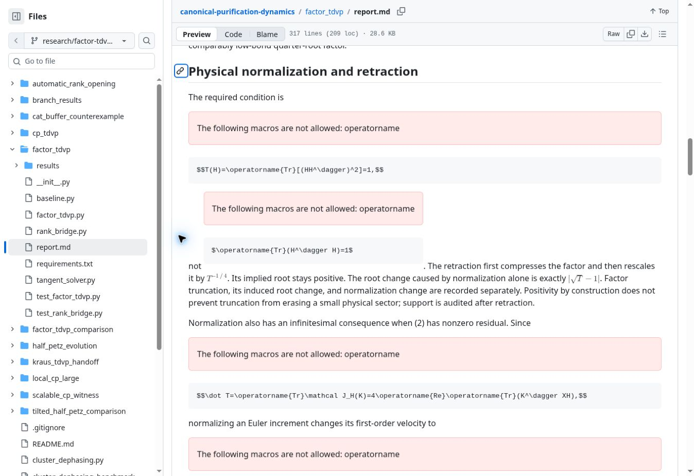
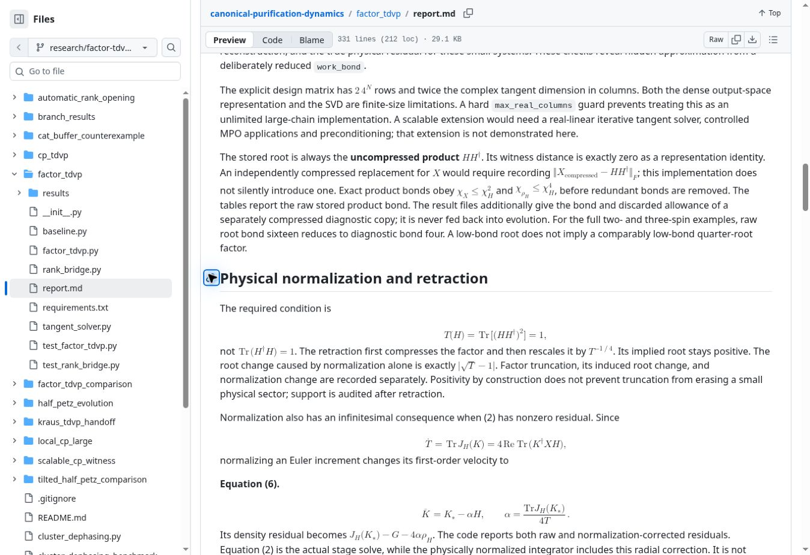
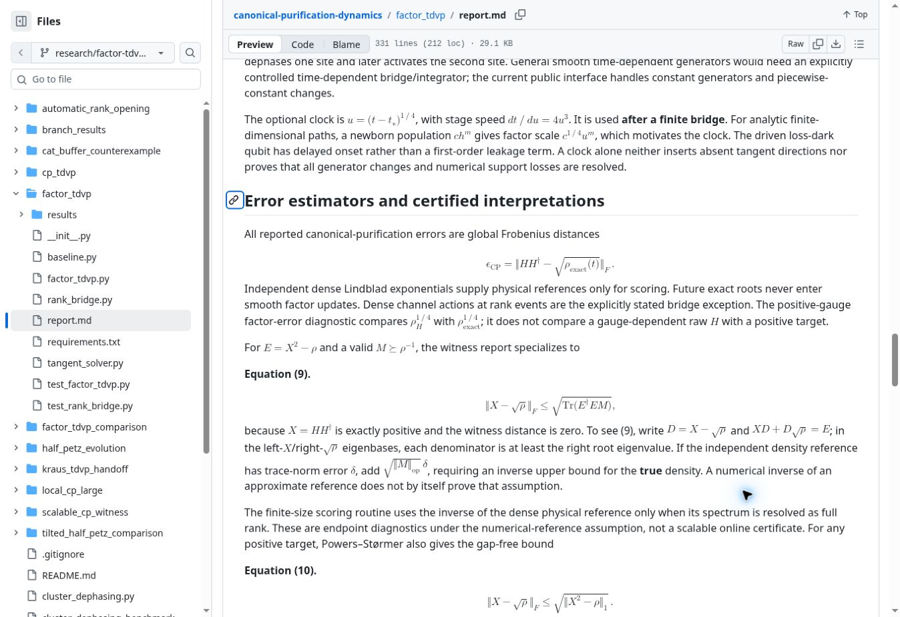
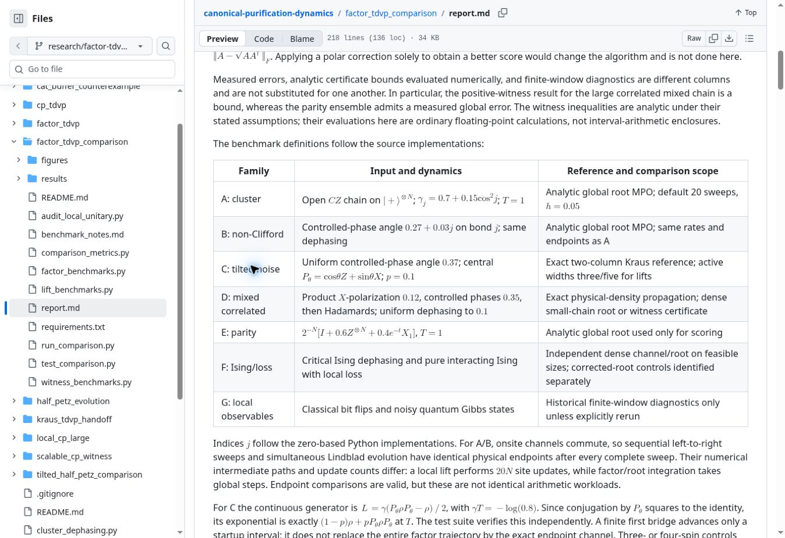

# Mathematical rendering verification

Verified on the live GitHub branch `research/factor-tdvp-benchmarks` on 2026-11-14, at Markdown commit `bcbcc31ef7fe073d31bd9ecbcb9f168e760e5c7c`. The scientific source was compared with pre-fix commit `cdd8e549f2f8a416446a549b56fa11cbaafeece4`.

## Observed causes and corrections

1. **Rejected macro.** GitHub displayed “The following macros are not allowed: operatorname” in the normalization identities, equations (6) and (9), adjoint-action notation, and comparison normalization. Upright `\mathrm{Tr}`, `\mathrm{Re}` and `\mathrm{ad}` retain the notation without that rejected macro.
2. **Markdown damaged inline TeX before math rendering.** Ordinary dollar-delimited formulas lost backslashes in norm bars and thin spaces; underscores created emphasis, and some formulas next to slashes or hyphens remained literal source. All 334 inline expressions in the two reports and root README now use GitHub's protected dollar/backtick delimiters. Table expressions use the same protection. The prior pipe fix in the comparison table was retained.
3. **Numbered-equation layout collapsed despite successful parsing.** Several unboxed `\tag` displays became narrow vertical stacks on the actual GitHub page. All ten numbers are now visible “Equation (n).” labels outside the math blocks. Their references are unchanged. The PDF builder restores conventional right-margin LaTeX numbers.
4. **Long displays.** The generator and comparison objective/Jacobian were split across lines with `aligned`/`gathered`. Their actual GitHub appearance was inspected. The existing math fences were retained; another delimiter-only conversion would not have fixed the observed failures.

## Verification performed

Both complete research reports and every Markdown file newly added on this feature branch were read. The other new Markdown files use intentional plain-text/code notation and required no math edits. The [machine-readable audit](math-rendering/audit.json) records content preservation and live-page checks.

| Source | Display expressions | Inline expressions | Rendered math nodes on GitHub |
|---|---:|---:|---:|
| `factor_tdvp/report.md` | 23 | 150 | 173 / 173 |
| `factor_tdvp_comparison/report.md` | 2 | 181 | 183 / 183 |
| `README.md` | 0 | 3 | 3 / 3 |

All 359 expressions, all numerical results, and the scientific prose were preserved, allowing only delimiter protection, equivalent operator typography, line layout, number relocation, and added navigation links. The rendered TeX of every report expression was compared with the corrected source. No rejected macros, missing math nodes, or exposed dollar-delimited expressions remained. Row/column counts were consistent across all eleven report tables.

**Visual verification was separate from those checks.** Live GitHub screenshots were inspected for equations (1)–(10), the multiline generator/objective, inline norms/subscripts, error bounds, and mathematical/numerical table entries. The corrected README was also inspected. This verifies the observed desktop GitHub preview; it does not claim testing every browser or viewport.

Before correction:



After correction:







## Typeset PDFs and rebuilding

- [Factor-TDVP note](../factor_tdvp/factor_tdvp_note.pdf): nine pages, including numbered equations (1)–(10).
- [Comparison report](../factor_tdvp_comparison/comparison_report.pdf): eleven pages, including tables and all three figures.

Rebuild from the authoritative Markdown with Python 3, Pandoc 3 or later, and XeLaTeX/TeX Live:

```sh
python docs/build_research_pdfs.py
```

The shared header and Lua filter are in `docs/`. Build intermediates and logs go to the ignored `run_outputs/research_pdfs/` directory. Relative repository links become GitHub hyperlinks in the PDFs. All twenty PDF pages were rendered and visually reviewed; equations, tables, and page boundaries were checked, in addition to the LaTeX warning checks. No scientific computation or benchmark was rerun for this documentation-only correction.
