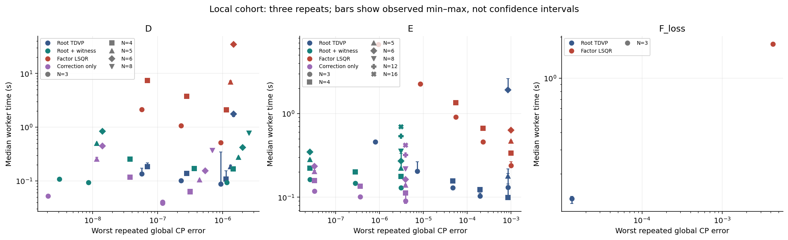
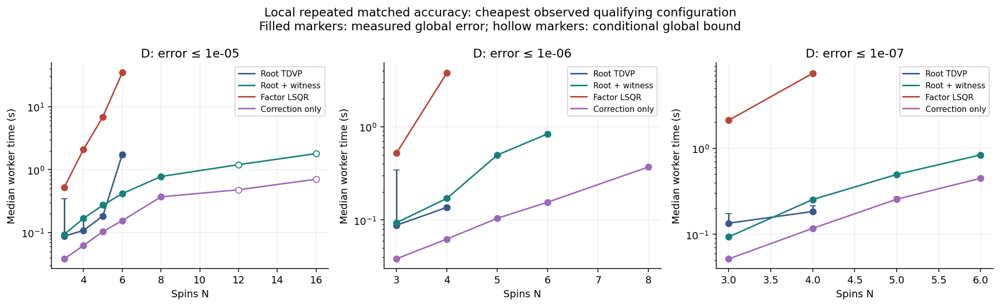
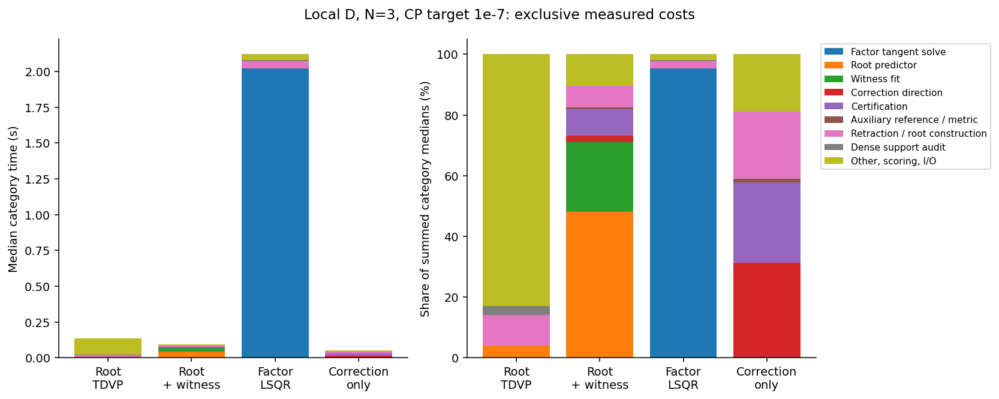
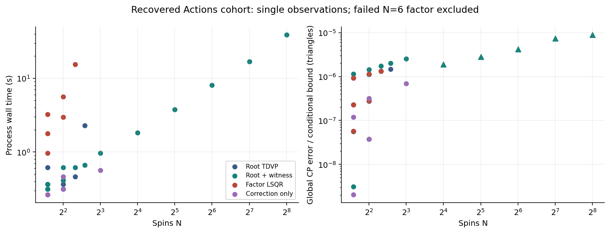

# Factor TDVP versus positive-witness correction: recovered and repeated scaling experiments

[All numerical tables](scaling_figures/tables.md) · [Repeated matched-accuracy data](scaling_figures/repeated_matched_accuracy.csv) · [Raw local experiments](scaling_runs/local_20261115/) · [Recovered Actions data](scaling_runs/actions_43745844867/) · [Original accelerated-method note](report.md) · [Handoff](../HANDOFF.md)

The repeated correlated-chain experiments establish an **implementation-specific slowdown at matched global canonical-root error**. At three and four spins and error at most 1e-7, direct factor MPO-LSQR takes median 2.120 and 7.439 seconds; root plus positive witness takes 0.09345 and 0.25399 seconds, including its independently propagated density, inverse-metric construction, certification, and scoring. The ratios are 22.69 and 29.29. At six spins and target 1e-5, the corresponding medians are 34.93 and 0.4163 seconds, a ratio of 83.92. Three repetitions of each selected configuration meet its accuracy target.

This does not establish a universal ordering or an asymptotic complexity separation. Different represented bonds, restricted tangents, force implementations, and access to physical-reference information are material differences. Failed and unsupported large-chain trajectories provide no measured runtime comparison. The factor force is matrix-free, while its current general trajectory adapter retains dense support and scoring routines.

## Recovery and provenance

The complete artifact from [Actions run 43745844867](https://github.com/xiaoyanghuangphys-create/canonical-purification-dynamics/actions/runs/43745844867), artifact ID 14174167664, is preserved under `scaling_runs/actions_43745844867/`. The run used source commit `5cfb7dd`. Its numerical step and artifact upload completed; the later Git push was rejected because the remote branch had advanced. The recovered [job log](scaling_runs/actions_43745844867/JOB_LOG.txt) distinguishes that publication failure from numerical failures.

The archive SHA256 is `b0a82dcb403875d5083fa49c8b0ca7e69574f7b652aa0d56874ac16baac065b0`. All **165 original extracted files remain byte-identical** to the [recovery manifest](scaling_runs/actions_43745844867/RECOVERY_MANIFEST.json). The added job log and generated analysis are outside that immutable manifest. The independently generated [integrity audit](scaling_figures/recovery_audit.json) verifies every hash, parses every JSON/CSV/NPZ and text log, compares all 31 individual measurements with their aggregate table, compares factor/root stdout with summaries, and compares witness endpoint CSV values with measurements. All checks pass. Saved tensor arrays are finite.

There are **30 completed recovered cases and one numerical failure**. The latter is the N=6 factor trajectory with work bond 32: `CompressionError` is raised before any accepted time step. Its 0.615-second process duration is failure latency, not the cost of a completed trajectory. The full error and partial diagnostics remain in the raw files.

The Actions cohort used Python 3.11.18, NumPy 2.1.2 and SciPy 1.16.2, with a one-thread BLAS request and a 90-second worker timeout. Its exact CPU and memory were not captured; no runner hardware is inferred. These are single observations. They are not pooled with the local repeated cohort or old benchmark timings.

The updated publication workflow was also exercised in [Actions run 43747960010](https://github.com/xiaoyanghuangphys-create/canonical-purification-dynamics/actions/runs/43747960010), which completed its benchmark, upload and publication steps successfully. This is a publication/reproduction control; its timings are not pooled with the local repeated results.

## Benchmark definitions and comparison rules

- **D, correlated full-rank chain:** product states with X polarization 0.12, nearest-neighbor controlled-phase gates of angle 0.35, then Hadamards, followed by uniform Z dephasing to time 0.1. This isolates smooth full-rank dynamics.
- **E, noncommuting parity:** the density is given below, with final time 1. Its analytic canonical root provides an independent global accuracy check, including at large N.
- **F_loss, interacting loss control:** the existing three-spin interacting Hamiltonian and local-loss model, ten intervals to time 0.03. This is a small-population/rank-opening stress control. The native witness implementation does not implement this interacting model, so the F control compares root and factor evolution only; no unrelated witness trajectory is substituted.

```math
\rho_E(t)=2^{-N}\left[I+0.6 Z_1\cdots Z_N+0.4e^{-t}X_1\right].
```

Four methods are distinguished throughout D and E:

| Method | Evolving/updated representation | Auxiliary physical information |
|---|---|---|
| Conventional root TDVP | One-site root tangent evolution, legacy dense Sylvester force | Independent density/root used for scoring |
| Root + witness | Existing two-site MPO predictor, fitted witness, certified endpoint corrections when needed | Independently propagated density and inverse-bound metric used during evolution |
| Direct factor LSQR | One-site factor tangent evolution under the original density-residual objective | Independent reference used for scoring; no reference endpoint correction |
| Correction only | Existing positive-factor endpoint corrections without the TDVP predictor | Same reference and metric resources as root + witness |

The conventional root and witness predictor are different implementations; the witness uses the repository's preconditioned approximate MPO Sylvester force and two-site tangent update. It is therefore incorrect to attribute every timing difference to adding a witness to an otherwise identical integrator.

For small D/E, root and factor use 5, 10 and 20 time steps; correction methods use five endpoints and requested certificate tolerances 1e-5, 1e-6 and 1e-7. Larger sizes and additional settings are listed in the raw configurations. Every matched-accuracy entry selects the lowest **median observed worker time** among actually executed configurations at the same family, N, endpoint and target. All three repeats must complete and satisfy the target; selecting just the fastest successful repeat is prohibited. The range is the observed minimum and maximum, not a confidence interval. No claim of globally optimized cost follows from this finite parameter sweep.

A supplemental E3 refinement adds 50- and 150-step root/factor trajectories, each repeated three times, after the original 5/10/20-step grid failed to reach 1e-5. Supplemental directories and source provenance are preserved separately and combined by path only; historical measurements are unchanged.

The primary selection uses the independently measured global error when available. A reported conditional bound is used only when a measured global error is unavailable. A configuration requested at certificate tolerance 1e-6 can legitimately qualify for measured error 1e-7; the table retains its actual error and bound separately. The resulting measured-error frontier is not an online certificate guarantee at the same target.

```math
\epsilon_{\rm CP}=\|X-\sqrt{\rho_{\rm reference}}\|_F,
\qquad X=HH^\dagger\quad\hbox{for direct factor evolution}.
```

No optimization over purification gauge and no local-marginal proxy is applied to this error.

## Timing, hardware, memory and instrumentation

The new cohort is in [local_20261115](scaling_runs/local_20261115/), with environment and source hashes saved beside the measurements. It uses macOS 26.5.1 arm64, Python 3.9.6, NumPy 2.0.2 and SciPy 1.13.1. The independently checked hardware is [Apple M2 with 8 GiB RAM](scaling_runs/local_20261115/hardware_verified.json). The launcher requests one thread through OpenBLAS, OMP, MKL, Accelerate and NumExpr environment variables. Initial automatic BLAS introspection was unavailable; a separate [NumPy build-configuration check](scaling_runs/local_20261115/blas_verified.json) verifies Apple Accelerate BLAS/LAPACK. The one-thread setting is a request, not a measured active-thread count.

`total_seconds` is worker wall time, including setup, required physical propagation, metric construction, fitting/corrections, certification, scoring and checkpoint I/O. It excludes interpreter/import startup. `wall_seconds` is parent-observed process time including startup and monitoring. The 250-ms monitor polling interval makes process times visibly quantized; worker times are used for the repeated frontier. Old Actions process timings and new worker timings are never used in one ratio.

Timing wrappers leave the numerical algorithms unchanged. Nested exclusive categories partition each worker's time; inclusive categories are contextual and must not be summed. `other_worker_seconds` includes uninstrumented scoring, correction application, I/O and setup. Medians of individual categories need not sum exactly to the median total. The [local audit](scaling_figures/local_audit.json) checks the per-run timing partition and measurement consistency.

Workers have a 45-second time limit and a configured 2 GiB RSS policy. **The initial parent RSS polling was blocked by the sandbox:** zero `peak_observed_rss_mib` entries mean unavailable monitoring, not zero memory use, and those early runs cannot be described as having an enforced RSS cap. Child `getrusage` peak RSS remains available for completed runs. Hardware and monitoring corrections are documented separately without replacing the original measurements. Timeout, memory-limit, numerical-failure, unsupported-adapter and budget-not-run statuses remain distinct.

More precisely, the primary suite uses 45-second worker limits; the supplemental suite defaults to 60 seconds with explicit 120-second D256/D512 witness retries; the final E8 refinement uses 45 seconds. Later workers use a separately validated, sampled child RSS watchdog. Its 250-ms interval can permit transient overshoot. [Collection provenance](scaling_runs/local_20261115/collection_provenance.json) records the source-table hashes, source-snapshot limitation, and monitor correction; early raw monitoring statements are retained as historical records rather than retrospectively rewritten.

## Strong repeated matched-accuracy results

All entries below are worker seconds, median [minimum, maximum] over three repeats. Full errors, bounds, selected configurations, bonds, resource limits and directories are in the [machine-readable frontier](scaling_figures/repeated_matched_accuracy.json).

| D spins | CP target | Conventional root | Root + witness | Factor LSQR | Correction only |
|--:|--:|--:|--:|--:|--:|
| 3 | 1e-5 | 0.08768 [0.08674, 0.3454] | 0.09345 [0.09315, 0.09503] | 0.5203 [0.5165, 0.5227] | 0.03827 [0.03814, 0.03851] |
| 3 | 1e-6 | 0.08768 [0.08674, 0.3454] | 0.09345 [0.09315, 0.09503] | 0.5203 [0.5165, 0.5227] | 0.03827 [0.03814, 0.03851] |
| 3 | 1e-7 | 0.1347 [0.1283, 0.1736] | 0.09345 [0.09315, 0.09503] | 2.120 [2.098, 2.126] | 0.05185 [0.05173, 0.05257] |
| 4 | 1e-5 | 0.1083 [0.1065, 0.1544] | 0.1681 [0.1672, 0.1692] | 2.100 [2.081, 2.171] | 0.06237 [0.06227, 0.06261] |
| 4 | 1e-6 | 0.1365 [0.1361, 0.1409] | 0.1703 [0.1703, 0.1768] | 3.786 [3.781, 3.858] | 0.06237 [0.06227, 0.06261] |
| 4 | 1e-7 | 0.1844 [0.1781, 0.2144] | 0.2540 [0.2517, 0.2542] | 7.439 [7.185, 7.686] | 0.1175 [0.1174, 0.1196] |
| 5 | 1e-5 | 0.1837 [0.1829, 0.1950] | 0.2737 [0.2728, 0.2753] | 6.919 [6.897, 7.230] | 0.1041 [0.1025, 0.1045] |
| 6 | 1e-5 | 1.754 [1.577, 1.819] | 0.4163 [0.4114, 0.4204] | 34.93 [34.82, 35.48] | 0.1551 [0.1541, 0.1590] |

At target 1e-7, factor uses 20 steps and witness uses five endpoints. Worst repeated errors are 5.698e-8 versus 8.649e-9 at N=3, and 6.952e-8 versus 3.776e-8 at N=4. For N=3, the fastest qualifying witness configuration requested tolerance 1e-6; its final measured error is substantially better. This is a finite-sweep selection, not evidence that a looser tolerance always runs faster or always attains a tighter error.

The conventional root method is faster than root+witness in the N=4 table even at 1e-7; correction-only is faster than both in these D controls. The data therefore do not support a universal benefit from adding the predictor. The absence of a predictor can be advantageous when a cheap, independent physical density is already available and a direct endpoint correction converges.

The new N=6 factor runs use **work bond 64** and complete at error 1.4705e-6; the recovered work-bond-32 failure is retained. This is a measured recovery by increasing a computational resource, not evidence that the earlier failure was an intrinsically impossible system size. The N=5/6 factor sweep used five steps only, so it does not establish the minimum cost at targets 1e-6 or 1e-7. Their successful witness/correction configurations at those targets are listed separately; absent factor entries mean unachieved in this sweep.





Filled points in the matched-scaling figure qualify by measured global error; hollow points qualify by a conditional global bound. In particular, large-D witness results must not be read as exact error measurements.

## Parity, interacting loss, and large-size coverage

The primary local sweep contains 310 rows: 275 completed trajectories, two guarded numerical failures, three timeouts, and 30 explicitly unsupported adapter/size combinations. A **completed** status means that the trajectory reached its endpoint; it does not mean it achieved a target CP error.

The final collection, including supplemental refinements and resource retries, contains **328 rows: 289 completed, five numerical failures, four timeouts, and 30 unsupported combinations**. The three source tables are retained separately with checksums. Their union changes only relative directory prefixes, never numerical values or timings; no constituent table is included twice.

The E3 refinement establishes matched-accuracy results on a second physical family:

| E3 target | Conventional root | Root + witness | Factor LSQR | Correction only |
|--:|--:|--:|--:|--:|
| 1e-5 | 0.2048 [0.2037, 0.2661] | 0.1304 [0.1304, 0.1307] | 2.267 [2.251, 2.274] | 0.09059 [0.08451, 0.1124] |
| 1e-6 | 0.4608 [0.4607, 0.4671] | 0.1469 [0.1465, 0.1479] | 6.713 [6.686, 6.782] | 0.1010 [0.1006, 0.1013] |

At 1e-6, factor uses 150 steps and attains worst repeated error 9.4475e-7, whereas witness uses five endpoints and attains 2.8321e-7. The median cost ratio is 45.71, with all auxiliary work included. Neither tested E3 root nor factor configuration reaches 1e-7; witness and correction-only do. This is evidence for a matched-error disadvantage at E3, not an E system-size scaling conclusion.

The F_loss control demonstrates that distinction. Over three repeats, conventional root has median 0.1317 seconds and global CP error 1.3383e-5; factor LSQR has median 1.773 seconds and error 4.2747e-3. Both miss even the 1e-5 target. Both use one positive channel bridge. The factor's density error is 6.405e-5 and maximum accepted stationarity ratio is 9.89e-9, yet its root error is much larger. This reproduces the small-population sensitivity from the earlier note: a small tangent normal residual is not a guarantee of accurate canonical-root evolution. No matched-accuracy speed ratio is assigned to this failed-accuracy control.

At N=8, both D and E factor attempts with work bond 16 return guarded `CompressionError`. These are resource-specific failures, not proof that an eight-spin factor trajectory is impossible. A separate E8 retry with factor cap 2 and work bond 64 completes five steps in 2.021 seconds, but its global CP error 1.0159e-3 does not meet the requested accuracy targets. The large root and factor adapter exclusions explicitly distinguish dense Liouvillian setup, dense support audits, and global validation from the MPO-only force itself.

The E8 50-step refinement was then executed three times with the same factor cap 2 and work bond 64. **All three terminate with `LinAlgError: SVD did not converge` after seven recorded accepted endpoints, through time 0.14 rather than the requested endpoint 1.** Their approximately 3.1-second worker durations are failure latencies, and no final CP error is assigned. There is no qualifying E8 factor point at 1e-5. The failed logs and partial trajectories are preserved in `parity_eight/`.

Read-only inspection of call counts localizes this failure **by inference to the finite dense endpoint-scoring SVD**, rather than the MPO-LSQR force: 16 force calls and 16 retractions returned, 39 support audits and nine reference calls place the interruption in step-eight scoring at time 0.16, before its record was appended. The scoring routine calls `numpy.linalg.svd(amplitude)` in [the historical comparison adapter](../factor_tdvp_comparison/factor_benchmarks.py). Through the seven accepted endpoints, the first 14 force solves have maximum relative force residual 4.21e-14, normal ratio 5.38e-14 and three iterations; the t=0.14 global CP error is 4.319e-6. Those partial checks cannot establish the final-time error. The failing matrix and a full traceback were not retained, so the LAPACK cause and the validity of the unscored endpoint remain unresolved. This result is not evidence of Krylov divergence or a demonstrated integration instability.

In the primary local large-D exploration, root+witness completes through N=128 (19.63 seconds, conditional bound 7.331e-6); correction-only completes through N=256 (25.47 seconds, conditional bound 9.007e-6). The 45-second attempts at D256 witness and D512 both correction methods time out. Their endpoint CP errors and completed runtimes are unavailable, and earlier partial accepted endpoints are not substituted for the requested final time. These failures do not invalidate the recovered completed D256 run on its different host and instrumentation. A separate 120-second-budget D256 witness retry completes in 44.74 worker seconds with bound 8.944e-6; the failed lower-budget process record is retained. Process and worker time differ because startup and monitoring also count against the parent timeout.

The 120-second D512 witness retry also times out. This remains an incomplete run, with no final-time bound or completed runtime to report. Historical 512-spin results in the earlier research notes used their own settings; they are not silently imported as successful executions of this experiment.

Large E is a stronger global-validation control because its analytic root is known. At N=512, the primary single-observation witness run completes in 22.45 seconds with **measured** global CP error 3.0895e-6 and bound 7.7431e-6; correction-only completes in 12.79 seconds with measured error 3.9636e-6 and bound 9.9329e-6. These demonstrate large-N operation of those two existing methods, not a large-N factor comparison or a repeated timing result. Large exploratory measurements and any resource retries remain separate from the repeated frontier.

## Why the costs differ

The witness fit and the factor tangent solve optimize different problems:

```math
\min_G\|X-GG^\dagger\|_F^2,
\qquad
\min_{K\in T_H\mathcal M_\chi}
\|\mathcal J_H(K)-\mathcal L((HH^\dagger)^2)\|_F^2.
```

The witness fit approximates an already proposed root. **Fitting alone does not correct the physical-density error.** The subsequent endpoint certificate uses the independently propagated target density; corrections use that residual and the inverse-root preconditioner. These are additional physical resources, whose computation is included in the reported total.

At the N=3, 1e-7 matched point, the factor tangent solves cost median 2.022 seconds of 2.120 total, about 95%. Dense support audits take 0.0104 seconds and retraction 0.0467 seconds. The witness's 0.09345-second total contains 0.0393 seconds of predictor force, 0.0216 seconds of witness fitting, 0.00816 seconds of certification, and 0.00203 seconds of correction-direction work; metric/reference initialization and propagation together are approximately 0.000695 seconds. These are nonoverlapping exclusive categories. The full inclusive fitting time also contains nested Hermitian retraction, charged separately in the exclusive ledger. Required auxiliary propagation is included in the worker total.

The **full inclusive witness-fitting** medians are 0.02393 seconds at N=3 and 0.04479 seconds at N=4 for those matched configurations. They include the fit's nested retractions and therefore must not be added to the exclusive retraction totals. These are inexpensive compared with the corresponding factor tangent solves, but are not zero-cost operations. `correction_direction` measures construction of a proposed correction, not the complete correction loop: candidate application, retraction, and trial certification are charged in their own categories or the residual `other` category and remain included in the total.

At N=4, 1e-7, factor force cost is 6.636 seconds, about 89% of total, with 0.691 seconds in factor retraction. Exclusive witness fitting and correction-direction work each cost about 0.0405 seconds, and certification 0.0348 seconds. The actual auxiliary reference/metric cost is small for these specially structured channels; it need not remain cheap for generic interacting dynamics.

At five-step D6 the factor force accounts for approximately 34.62 of 34.93 seconds. This directly identifies the tangent solve and its MPO arithmetic as the current dominant measured cost. By contrast, much of conventional root D6's 1.75-second total lies in its dense setup; the raw legacy summary separates that setup from evolution. A generic dense-setup bottleneck should not be misidentified as a matrix-free force bottleneck.



Recovered logs add an important qualification: at loose certificate tolerance 1e-5, D witness runs with N=3 through 8 perform **zero endpoint-correction trials**. Their MPO predictor plus fitted witness already passes the certificate. At 1e-7 the N=3/4 runs perform 5/39 correction trials. At larger N=16/32/64/128/256, the loose-tolerance runs perform 1/2/4/4/7 trials. Thus endpoint correction explains tight-accuracy improvement, but cannot explain every loose-accuracy timing advantage.

The factor solver replaces explicit Jacobian columns with MPO Jacobian and adjoint contractions, but still solves a real-linear least-squares problem at both midpoint stages. Its intermediate products and repeated compression are expensive; its restricted tangent retains physical gauge-null directions. The recovered five-step D3/4/5 solves take at most 11/46/40 Krylov iterations, with LSQR condition estimates about 12/140/5719. These estimates are not exact Jacobian condition numbers and do not prove that conditioning alone causes the cost trend. The factor cap changes from 4 to 16 to 4 across those sizes, while work bonds also change.

For the factor representation, the raw root bond can be the square of the factor bond and the raw density bond its fourth power. An equal nominal factor/root bond is not an equal representation budget. The tables therefore show factor and represented-root bonds separately. Positivity is automatic for the factor, but neither accurate dynamics nor low cost follows from positivity.

## Comparison with earlier results and scaling limits

The original explicit-factor comparison reported roughly 9.2 seconds versus 0.07 seconds for conventional root D3 at approximately 5.7e-8 error. The accelerated note subsequently measured a 27-fold six-spin **force-only** speedup over explicit column construction. These are historical results on their own environments and settings; neither number is divided into the present timings. The current repeated global trajectories confirm the qualitative conclusion: removing the exponential Jacobian representation helps substantially but leaves an end-to-end cost disadvantage on the measured D cases.

Recovered D process-wall factor/witness ratios at target 1e-5 are about 3.06, 7.16 and 25.2 for N=3,4,5. They are single observations from one Actions cohort. The repeated local ratios at target 1e-5 are about 5.57, 12.49, 25.28 and 83.92 for N=3,4,5,6. This is a consistently unfavorable trend **over the tested configurations**. The repeated D3/D4 ratios at 1e-7 increase from 22.69 to 29.29. Changing bonds, representation constraints and tolerance choices prevent extracting a universal scaling exponent from either short sequence.

The recovered witness method reaches N=256 with conditional global bound 8.944e-6 in 38.78 process-wall seconds. Actual D errors are computed through N=8; for larger D, the result is a bound under the physical-reference/inverse-metric assumptions. The calculation includes truncation allowances but no rigorous interval enclosure of floating-point roundoff. The E analytic root permits measured global errors at larger sizes and must be distinguished from D's bound-only evidence.



Dense limitations belong to the **trajectory adapter**, not to a mandatory dense output in the matrix-free force. Conventional root setup can construct a dense Liouvillian with squared physical-operator dimension. Factor trajectories retain dense factor/density support eigendecompositions and scoring. Unsupported large-N rows are explicit implementation/resource decisions. A timeout or guarded compression failure does not supply a successful runtime, does not establish an asymptotic lower bound, and cannot be plotted as a completed factor trajectory.

The strongest current conclusion is that direct factor evolution is slower at matched global error on the repeated D controls, while a universal system-size trend remains unestablished. Cheap auxiliary reference information is a real advantage of these witness benchmarks, and its cost has been included. Its availability is a structural assumption, not a resource that can be assumed free for all physical models.

## Concrete next developments

1. Precondition the restricted real tangent solve using reusable contraction environments, checking physical residual and canonical-root sensitivity as well as stationarity. Near small populations a small normal residual is insufficient.
2. Reduce repeated product/compression work and cache appropriate local environments. Reuse velocities only after projection into each new tangent frame. Validate compressed adjointness and residuals before using aggressive truncation.
3. Separate a production tensor-network support monitor from dense validation. A scalable force does not by itself supply scalable rank opening, finite positive-channel bridging or support auditing.
4. Compare adaptive time/bond resources under the same information budget. A corrected-factor variant would be a separate algorithm and should be reported as such.
5. Extend repeated matched-error trajectories only after their smaller cases pass global accuracy checks. Pure product force tests and uncompleted large correlated trajectories are not substitutes.

## Reproduction and validation

```bash
OPENBLAS_NUM_THREADS=1 python3 -m factor_tdvp_accelerated.repeated_scaling \
  --suite all --out factor_tdvp_accelerated/scaling_runs/<new-run> \
  --timeout 45 --memory-mib 2048 --budget 840
OPENBLAS_NUM_THREADS=1 python3 -m factor_tdvp_accelerated.repeated_scaling \
  --suite supplemental --out factor_tdvp_accelerated/scaling_runs/<new-supplement> \
  --timeout 60 --memory-mib 2048 --budget 420
OPENBLAS_NUM_THREADS=1 python3 -m factor_tdvp_accelerated.repeated_scaling \
  --suite parity_eight --out factor_tdvp_accelerated/scaling_runs/<new-E8-refinement> \
  --timeout 45 --memory-mib 2048 --budget 140
MPLCONFIGDIR=/tmp/tdvp-mpl python3 -m factor_tdvp_accelerated.analyze_scaling
```

Use a new output directory to retain historical measurements. The analysis script performs integrity and timing checks before generating tables and figures; it does not alter raw data. [The complete recovered-case table](scaling_figures/tables.md), [local repeated groups](scaling_figures/local_groups.csv), and [exploratory frontier](scaling_figures/exploratory_matched_accuracy.csv) include settings and omissions that do not fit the selected table above. Exploratory singletons are labeled separately and never enter the repeated frontier.

The final validation passes [70 numerical, accounting and frontier regression tests](scaling_validation/regression_tests.log) and [four publication integration tests](scaling_validation/publication_tests.log). Frontier regressions reject incomplete/duplicate repeats, missing/nonfinite accuracy or runtimes, and mixed final endpoints; mixed measured/bound evidence must qualify in every repeat. The production matrix-free solver and predecessor rank-opening regressions remain included. Publication tests exercise concurrent branch advances without force-pushing or overwriting historical measurements. The separately completed Actions run validates the publication path in GitHub itself.

The published GitHub preview at commit `164fb0d` was checked after loading its
math renderer. All three display-equation blocks render as typeset mathematics;
the parity definition and optimization objectives were also visually inspected.
The generated scaling and error/runtime plots were visually checked locally.
