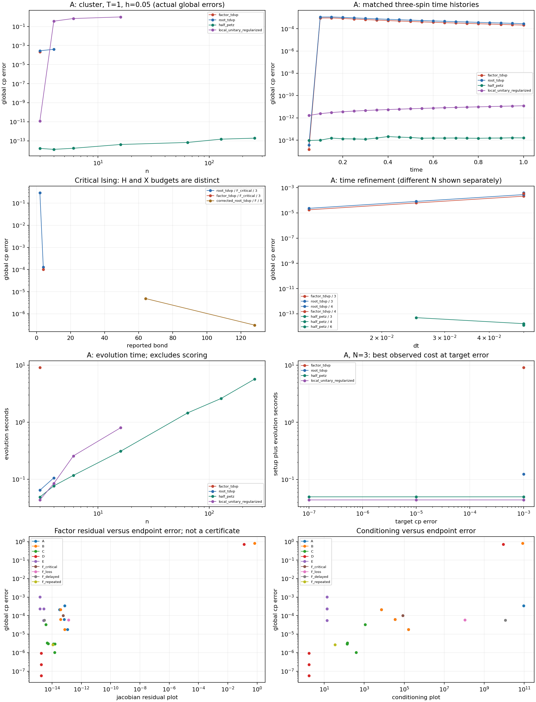
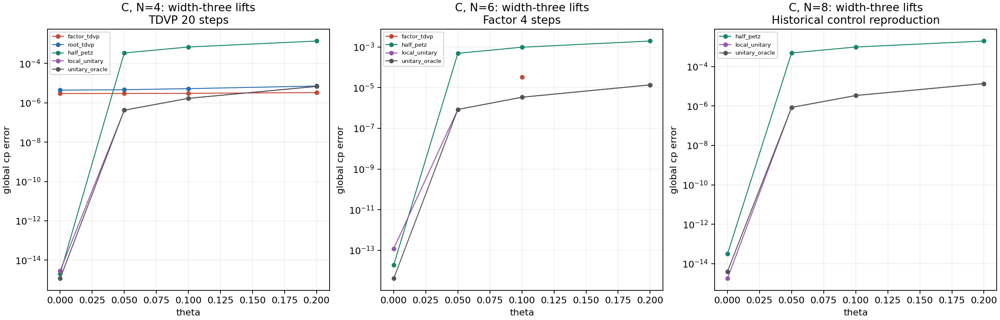
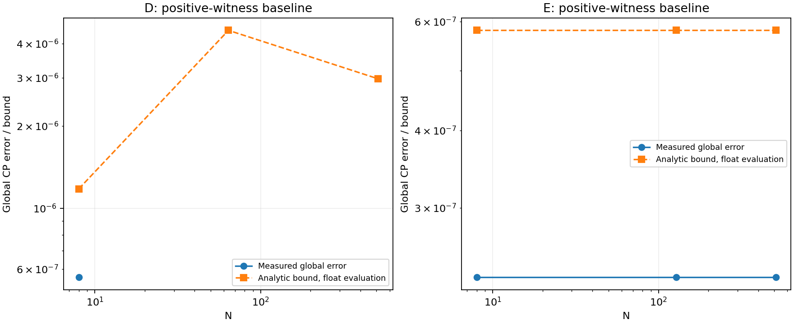

# Factor-TDVP compared with root evolution and local lifts

**Reading options:** [Typeset PDF](comparison_report.pdf) · [Factor-TDVP mathematical note](../factor_tdvp/report.md)

This study compares a direct factor-MPO evolution with conventional canonical-root TDVP, the positive-witness extension, practical local-unitary fitting, and the direct half-Petz lift. The factor implementation was recovered from the preceding local research commit and is included in [`../factor_tdvp`](../factor_tdvp). It was absent from the fork's initial `main`. Historical algorithms and result files are retained unchanged; new adapters, measurements, and plots are in this directory.

The factor method stores a generally non-Hermitian MPO $`H`$, with $`X=HH^\dagger`$ and physical density $`\rho_H=X^2`$. It solves a real least-squares problem for an actual one-site tensor tangent velocity of $`H`$. It does not evolve an independent root and fit a factor to that root. Positivity of the represented $`X`$ is exact by construction, but this does not by itself control its distance to the physical canonical root.

The measurements do not establish a practical advantage for the current factor implementation. It is often much slower than conventional root TDVP at comparable error, and some restricted-factor trajectories become inaccurate or fail while remaining positive. Existing half-Petz and positive-witness methods reproduce their large-chain results. One additional finding is that a practical finite-data unitary fit can have a tiny local residual yet fail globally on repeated cluster evolution; an independent occupied-span audit identifies the missing constraints rather than an indexing or cache bug.

## Experimental definitions and fair comparison

All measured global CP errors use the raw Frobenius norm

```math
\epsilon_{\rm CP}=\|A-\sqrt{\rho_{\rm reference}}\|_F.
```

Here $`A=HH^\dagger`$ for factor-TDVP and is the actually produced amplitude for the other methods. No purification-unitary or phase alignment is performed in scoring. For a general amplitude the physical density is $`AA^\dagger`$, so its density error is $`\|AA^\dagger-\rho_{\rm reference}\|_F`$. This agrees with $`X^2`$ when the factor-defined amplitude is positive. The separate canonical-branch defect is $`\|A-\sqrt{AA^\dagger}\|_F`$. Applying a polar correction solely to obtain a better score would change the algorithm and is not done here.

Measured errors, analytic certificate bounds evaluated numerically, and finite-window diagnostics are different columns and are not substituted for one another. In particular, the positive-witness result for the large correlated mixed chain is a bound, whereas the parity ensemble admits a measured global error. The witness inequalities are analytic under their stated assumptions; their evaluations here are ordinary floating-point calculations, not interval-arithmetic enclosures.

The benchmark definitions follow the source implementations:

| Family | Input and dynamics | Reference and comparison scope |
|---|---|---|
| A: cluster | Open $`CZ`$ chain on $`\lvert+\rangle^{\otimes N}`$; $`\gamma_j=0.7+0.15\cos^2j`$; $`T=1`$ | Analytic global root MPO; default 20 sweeps, $`h=0.05`$ |
| B: non-Clifford | Controlled-phase angle $`0.27+0.03j`$ on bond $`j`$; same dephasing | Analytic global root MPO; same rates and endpoints as A |
| C: tilted noise | Uniform controlled-phase angle $`0.37`$; central $`P_\theta=\cos\theta Z+\sin\theta X`$; $`p=0.1`$ | Exact two-column Kraus reference; active widths three/five for lifts |
| D: mixed correlated | Product $`X`$-polarization $`0.12`$, controlled phases $`0.35`$, then Hadamards; uniform dephasing to $`0.1`$ | Exact physical-density propagation; dense small-chain root or witness certificate |
| E: parity | $`2^{-N}[I+0.6Z^{\otimes N}+0.4e^{-t}X_1]`$, $`T=1`$ | Analytic global root used only for scoring |
| F: Ising/loss | Critical Ising dephasing and pure interacting Ising with local loss | Independent dense channel/root on feasible sizes; corrected-root controls identified separately |
| G: local observables | Classical bit flips and noisy quantum Gibbs states | Historical finite-window diagnostics only unless explicitly rerun |

Indices $`j`$ follow the zero-based Python implementations. For A/B, onsite channels commute, so sequential left-to-right sweeps and simultaneous Lindblad evolution have identical physical endpoints after every complete sweep. Their numerical intermediate paths and update counts differ: a local lift performs $`20N`$ site updates, while factor/root integration takes global steps. Endpoint comparisons are valid, but these are not identical arithmetic workloads.

For C the continuous generator is $`\mathcal L=\gamma(P_\theta\rho P_\theta-\rho)/2`$, with $`\gamma T=-\log(0.8)`$. Since conjugation by $`P_\theta`$ squares to the identity, its exponential is exactly $`(1-p)\rho+pP_\theta\rho P_\theta`$ at $`T`$. The test suite verifies this independently. A finite first bridge advances only a startup interval; it does not replace the entire factor trajectory by the exact endpoint channel. Three- or four-spin controls have windows clipped by boundaries and must not be identified with the bulk six/eight-spin approximate-reversibility benchmark.

## Algorithms and what their resources mean

The factor velocity minimizes

```math
\begin{gathered}
\|\mathcal J_H(K)-\mathcal L((HH^\dagger)^2)\|_F^2,\\
\mathcal J_H(K)=X(KH^\dagger+HK^\dagger)+(KH^\dagger+HK^\dagger)X.
\end{gathered}
```

The code constructs MPO Jacobian columns on an orthonormal one-site tangent basis, includes both $`B_j`$ and $`iB_j`$, and solves the resulting real system by rank-revealing SVD. The physical right-unitary gauge produces null directions; least-squares stationarity and physical residual are reported separately. The state is normalized by $`H\mapsto H/\mathrm{Tr}[(HH^\dagger)^2]^{1/4}`$. For restricted tangents, normalization adds the radial correction described in the factor report; it is not claimed to solve a different trace-constrained least-squares problem.

A rank event triggers an actual CPTP physical-channel bridge. With $`Z'=[K_\mu HH^\dagger]_\mu=U\Sigma V^\dagger`$, the new factor is $`U\Sigma^{1/2}U^\dagger`$. The bridge preserves positivity and inserts quarter-root populations without singular inverses. Leakage, delayed jump directions, and post-compression support are audited before smooth continuation. An unresolved handoff is a guarded failure, not an accepted step. A quartic-root time coordinate is an integration option after startup, not a replacement for the bridge.

Conventional root TDVP minimizes an unweighted root-velocity discrepancy after obtaining a Sylvester force. Factor-TDVP instead weights a root-velocity error by the squared Sylvester denominators $`(x_a+x_b)^2`$. Thus factor positivity and a different variational objective change the numerical problem. Equal bond caps do not give identical variational freedom: a factor of bond $`\chi_H`$ yields a raw root product of bond at most $`\chi_H^2`$. Tables therefore retain both factor and root bonds, rather than presenting $`\chi_H`$ alone as a matched root budget.

The positive-witness method has an additional independently evolved physical density and inverse-bound metric; it may correct an inaccurate TDVP predictor using those data. Its result is consequently not evidence for the predictor alone. The critical eight-spin values near $`4.92\times10^{-6}`$ and $`3.10\times10^{-7}`$ are historical **corrected** root results at bonds 64 and 128, not plain root-TDVP measurements. New results keep these method names separate.

The practical local-unitary fit uses an active doubled window plus a larger physical fitting window. Half-Petz uses its active physical window and independently propagated local physical factors. Neither is charged for a global analytic target during evolution. The exact-target unitary optimum is an oracle when shown and is not included as a practical competitor in cost-at-accuracy conclusions.

## Timing, memory, and scope

Setup, physical-data preparation, evolution/optimization, and reference scoring are split where the underlying interface exposes them. `total_seconds` is the measured common end-to-end interval for that run. Some native witness runs expose only a combined evolution/certification duration; missing subdivisions remain null, not estimated. Reference scoring can be substantial for small dense controls and is excluded from evolution-only comparisons. Timings are single-run observations with one requested BLAS thread; concurrent benchmark processes and machine scheduling can affect them. They are not a calibrated hardware performance model.

Process peak resident memory is a high-water mark when reported, not an exact allocation attribution to a particular step. The factor profiler separately records output-space dimensions and solve time. The current factor implementation explicitly materializes a real Jacobian with $`2\,4^N`$ rows. Fixed MPO bond therefore does **not** make this implementation polynomial in $`N`$. Its dense support audit and dense general channel bridge are additional limitations. Missing large-$`N`$ factor rows are marked unsupported/resource-limited; no local marginal is used to invent a global error for those rows.

The factor fields `average_h_bond` and `average_x_bond` are time averages of each step's maximum spatial bond, not averages over all cuts. Their corresponding `max_` fields are maxima over the whole recorded trajectory. The root product is kept factor-defined; it is not silently compressed into an independent amplitude with a zero witness distance.

## Recorded results

The authoritative measurements are in [`results`](results). Successful execution is not an accuracy claim: a completed low-bond or small-window run can have a large error. Uncomputed metrics are null. All figures below refer to this run unless explicitly labeled historical.







### Matched A/B factor and conventional-root trajectories

On three spins the full-capacity factor/root controls give:

| $`h`$ | Factor CP error, A | Root-TDVP CP error, A | Factor evolution seconds | Root evolution seconds |
|---:|---:|---:|---:|---:|
| 0.05 | $`2.11558\times10^{-4}`$ | $`2.82433\times10^{-4}`$ | about 9 | about 0.07 |
| 0.025 | $`6.18492\times10^{-5}`$ | $`8.12061\times10^{-5}`$ | about 18 | about 0.13 |
| 0.0125 | $`1.76907\times10^{-5}`$ | $`2.30477\times10^{-5}`$ | about 37 | about 0.3 |

The B errors agree at the displayed precision. At this size both manifolds have full expressivity; conjugating by the diagonal preparation circuit gives a useful non-Clifford consistency check. Factor-TDVP uses a quartic clock and root TDVP a square-root clock after a common exact physical startup interval. The first bridge time is $`h`$ and changes with grid refinement. Thus these rows measure the complete chosen discretizations, not a clean isolated experiment on variational objectives. Refinement reduces errors, but the factor solver's modest accuracy improvement at matched endpoint grids is overwhelmed by the much larger force cost. Half-Petz on the same three-spin inputs reaches about $`10^{-14}`$ in roughly $`0.05`$ evolution seconds, without time refinement.

The four-spin cap-four factor tests expose a substantial stability limitation. A stops at $`t=0.5`$ with `SVD did not converge in Linear Least Squares`, rather than reaching $`T=1`$. Its maximum retained Jacobian condition number is about $`7.85\times10^{10}`$; root retraction and normalization changes had already become enormous. Positivity and normalization remained valid for the accepted factor states, so those properties alone did not detect loss of physical accuracy. B reaches $`T=1`$ but its global error is about $`0.814`$, compared with conventional root TDVP near $`3.98\times10^{-4}`$. These cases must not be counted as successful controlled-accuracy factor trajectories. They motivate a physical-error/retraction controller and conditioning-aware regularization or bond growth, not just faster linear algebra.

Increasing the A4 factor cap to sixteen on the same 20-interval grid permits completion with global error $`3.46233\times10^{-4}`$, in about 67.3 seconds. The final factor bond is twelve and its raw root-product bond 144, compared with conventional root bond four. The exact positive-gauge quarter root on this commuting family has a bond-four representation, but the evolving nonpositive-gauge factor is not forced to maintain that favorable representation. The rescue demonstrates a useful numerical capacity effect, not that the chosen unrestricted gauge is representation-optimal.

### Full-rank D/E and tilted C on matching small inputs

On D at three spins, both methods use the physical clock, have no startup bridge, and reproduce the full physical velocity to numerical precision. Their endpoint accuracy is almost the same:

| D, $`T=0.1`$ | Factor error | Root-TDVP error | Factor end-to-end seconds | Root end-to-end seconds |
|---|---:|---:|---:|---:|
| 5 steps | $`9.324\times10^{-7}`$ | $`9.276\times10^{-7}`$ | 2.34 | 0.022 |
| 10 steps | $`2.296\times10^{-7}`$ | $`2.285\times10^{-7}`$ | 4.70 | 0.038 |
| 20 steps | $`5.698\times10^{-8}`$ | $`5.669\times10^{-8}`$ | 9.20 | 0.070 |

The quarter-root parameterization provides no accuracy advantage here. At four spins with factor cap four, D instead gives error $`0.720`$ and condition number about $`8.81\times10^9`$, while root TDVP at root cap four gives $`3.05\times10^{-7}`$. This is another restricted-factor failure, not a rank-opening problem: the input and physical trajectory are full rank. Possible explanations include the gauge selected by the unconstrained factor solve interacting badly with the tensor manifold and retraction. A gauge-controlled comparison is needed to establish that mechanism; it is not proved by these data.

On the three-spin E parity ensemble, factor errors at 5, 10, and 20 steps are $`1.016\times10^{-3}`$, $`2.316\times10^{-4}`$, and $`5.530\times10^{-5}`$; the root-TDVP errors are $`8.559\times10^{-4}`$, $`1.964\times10^{-4}`$, and $`4.704\times10^{-5}`$. The factor remains bond two and the root product bond four, whereas conventional root TDVP stores bond two. A four-spin factor run gives the same error $`2.316\times10^{-4}`$ at ten steps, consistent with the family’s analytic global structure. This validates sensitivity to the parity information at feasible sizes, but the positive-witness method remains much more accurate and scalable in the demonstrated implementation.

For C at four spins and $`\theta=0.1`$, factor/root errors are $`3.0354\times10^{-6}`$/$`5.2499\times10^{-6}`$ on 20 intervals and $`1.0157\times10^{-6}`$/$`6.0989\times10^{-7}`$ on 80 intervals. Factor end-to-end time grows from about 29.1 to 122.9 seconds, while the root runs take about 0.106 and 0.415 seconds. The relative accuracy ordering reverses under this refinement. Changing startup time and using different onset clocks make it inappropriate to attribute the reversal solely to the two variational objectives.

Where both tangent representations reproduce the exact physical derivative, the two continuous equations give the same density evolution; differences between these numerical trajectories are parameterization, discretization, and retraction effects. The current data do not isolate a universal advantage of the density-residual variational objective itself.

### Reproduced local-lift baselines

The original half-Petz engine reproduces global roundoff-level accuracy after 20 full sweeps:

| Family | $`N`$ | Root bond | Global CP error | Evolution seconds | End-to-end seconds |
|---|---:|---:|---:|---:|---:|
| A: cluster | 256 | 4 | $`1.90\times10^{-13}`$ | 5.68 | 6.37 |
| B: non-Clifford | 256 | 4 | $`4.78\times10^{-13}`$ | 5.42 | 6.01 |

The numerical values differ slightly from the historical $`3.00\times10^{-13}`$ and $`5.40\times10^{-13}`$, as expected for accumulated floating-point error. They reproduce the substantive result: global root accuracy at numerical precision with bond four and finite $`h=0.05`$. These are measured global MPS distances, not local-marginal proxies. The factor backend does not reproduce this system size.

The tilted single-update test reproduces the previous eight-spin, three-site-support values at $`\theta=0.1`$:

| Method | Active width | Global CP error |
|---|---:|---:|
| Half-Petz | 3 | $`9.82213518\times10^{-4}`$ |
| Practical local-data unitary | 3 | $`3.39894998\times10^{-6}`$ |
| Exact-target unitary oracle | 3 | $`3.39771851\times10^{-6}`$ |
| Half-Petz | 5 | $`1.30\times10^{-14}`$ |
| Practical local-data unitary | 5 | $`1.08\times10^{-13}`$ |

The three-site practical unitary is about 289 times more accurate than three-site half-Petz on this input, but it uses a five-site physical fitting region. At 256 spins the corresponding width-three errors remain $`9.82213518\times10^{-4}`$ and $`3.39894998\times10^{-6}`$. Their width-five errors are about $`2.2\times10^{-14}`$ and $`2.1\times10^{-14}`$. The small-window error is therefore a spatial-support effect in this family. It is not repaired by merely integrating the same finite channel in smaller time increments.

At four spins, the same central tilted channel is a boundary variant. Width-three half-Petz gives $`6.87187\times10^{-4}`$ and the practical unitary gives $`1.68876\times10^{-6}`$ at $`\theta=0.1`$. These are the appropriate references for the feasible four-spin factor comparison; substituting the bulk eight-spin numbers would be unfair.

### A repeated-unitary failure and its independent audit

The repeated adapter uses the original local physical-root Procrustes objective with the regularized identity completion, independently updated physical windows, active width at most three, and one further fitting site on each side. On non-Clifford B it gives small global errors (about $`10^{-9}`$ on four spins), but on exactly Clifford cluster A the four- and six-spin errors are about $`0.361`$ and $`0.684`$. Increasing the state bond does not cure them. These rows are successful executions that **miss the accuracy target**, not successful accurate trajectories. The unregularized completion also fails, with a different error; the report does not select the more favorable completion and relabel it as the original method.

An independent first-gate audit isolates the cause on four cluster spins. At the left boundary, the active region contains two sites and the fitting region three. The local fitting residual is $`5.77\times10^{-13}`$, yet the global CP error after applying that gate is $`0.10226`$. The cached marginal agrees with a direct partial trace within $`1.45\times10^{-16}`$, and applying the compact gate agrees with dense unitary application within $`8\times10^{-16}`$, ruling out these two wrapper errors. The source row space of the local canonical-root fit has rank two and misses a norm $`1/\sqrt2`$ component of the actual global amplitude rows. The selected unitary completion is therefore not fixed on all globally occupied directions. Expanding the fitting region to the whole four-site chain restores source rank four and error about $`1.15\times10^{-12}`$; an exact-target optimum on the same two-site active region reaches about $`10^{-15}`$.

This is an ambiguity of the chosen finite-data fitting objective and its extension in the degenerate cluster case. It does not show that a local unitary lift is impossible; the exact-target control demonstrates the opposite. It also does not contradict the successful single-update tilted comparison. Half-Petz is accurate on the same repeated cluster trajectory. A small local Procrustes residual cannot therefore serve as a global CP certificate, even in this exactly locally reversible family.

### Reproduced positive-witness controls

The existing positive-witness predictor/correction implementation was executed without changing its algorithm:

| Family | $`N`$ | Root / witness bonds | Measured global CP error | Global certificate bound |
|---|---:|---:|---:|---:|
| D: correlated mixed | 8 | 6 / 4 | $`5.59706\times10^{-7}`$ | $`1.17771\times10^{-6}`$ |
| D: correlated mixed | 64 | 6 / 4 | not computed | $`4.46661\times10^{-6}`$ |
| D: correlated mixed | 512 | 8 / 6 | not computed | $`2.97180\times10^{-6}`$ |
| E: parity | 8 | 2 / 2 | $`2.31662\times10^{-7}`$ | $`5.80532\times10^{-7}`$ |
| E: parity | 128 | 2 / 2 | $`2.31662\times10^{-7}`$ | $`5.80532\times10^{-7}`$ |
| E: parity | 512 | 2 / 2 | $`2.31662\times10^{-7}`$ | $`5.80532\times10^{-7}`$ |

The D512 run took approximately 81.7 seconds end to end, with a measured process peak RSS near 759 MiB. Its native timing interleaves prediction, endpoint correction, and certification, so it cannot be labeled pure tangent-evolution time. The raw physical-density Frobenius error can be extremely small in a large mixed chain because the density norm itself shrinks with dimension. It is not substituted for a canonical-root accuracy claim; the inverse-weighted certificate is the relevant reported control here.

Small three-spin witness runs also sweep requested certificate tolerances $`10^{-3},10^{-5},10^{-7}`$, enabling same-input comparisons with factor/root evolution. At the tightest setting D reaches measured error $`3.60\times10^{-8}`$ with bound $`7.32\times10^{-8}`$, and E reaches $`2.12\times10^{-8}`$ with bound $`5.31\times10^{-8}`$. These runs take about 0.42 and 0.57 seconds end to end. They include independent physical-density/metric information and correction work; their improvement is not attributed solely to the TDVP objective.

The eight-spin critical-Ising corrected-root trajectories also reproduce the requested bond dependence: at $`t=0.3`$, bond 64 gives $`4.92054\times10^{-6}`$ and bond 128 gives $`3.10420\times10^{-7}`$, with bounds $`1.19479\times10^{-5}`$ and $`7.60315\times10^{-7}`$. End-to-end times are approximately 8.19 and 9.24 seconds. These rows are explicitly labeled corrected root TDVP, including the physical-density endpoint correction; they are not presented as a conventional force-only baseline.

### Largest direct-factor trajectory and profiling

A budgeted six-spin C trajectory at $`\theta=0.1`$ completes four physical intervals to $`T=1`$, using factor cap four and intermediate work cap sixteen. Its first interval of duration $`0.25`$ is a finite positive bridge, followed by three genuine factor-tangent midpoint steps. The final global CP error is $`3.30767\times10^{-5}`$ and density Frobenius error $`2.8730\times10^{-5}`$; maximum Jacobian residual is $`3.76\times10^{-15}`$. Evolution takes about 110.4 seconds, and the process peak RSS is about 824 MiB. This is a controlled six-spin endpoint, not a six-spin A/B 20-sweep demonstration. The substantial startup fraction is part of its recorded algorithm and should be retained in any comparison.

At the same six-spin tilted endpoint, the practical width-three unitary already attains approximately $`3.40536\times10^{-6}`$ in a single finite update, and widening half-Petz to five active sites brings it close to numerical precision. The factor trajectory improves over width-three half-Petz's roughly $`10^{-3}`$ spatial error, but the measured cost and alternative window choice give no practical advantage for the current factor implementation.

A separate six-spin force evaluation at factor bond four has 416 real tangent columns, 208 retained image directions, and retained condition number about $`9.23\times10^3`$. It takes 21.26 seconds with physical residual $`9.59\times10^{-14}`$. The profiler attributes 20.46 seconds (about 96% of total wall time) to constructing/applying the 416 Jacobian columns. MPO compression accounts for 16.47 cumulative seconds, including 8.10 seconds in QR; dense SVD calls across the profile account for 1.68 seconds. Cumulative categories overlap, so these times must not be added. The dominant measured operation is repeated MPO column construction/compression, not the final least-squares factorization alone.

An eight-spin parity attempt with factor cap two, work cap eight, and five intervals was killed with exit code 137. No completed global error or completed runtime is available for it. The signal is recorded as a killed attempt under the benchmark budget; the available evidence does not establish the operating-system cause. It does not justify extrapolating the six-spin success to eight or hundreds of spins. Larger requested factor sizes are explicitly unsupported by the current run rather than assigned synthetic errors or timings.

### Interacting loss, delayed/repeated events, and critical stress

| Small stress control | Factor global CP error | Conventional root CP error | Factor bridge events |
|---|---:|---:|---:|
| Three-spin critical input, cap four, $`T=0.3`$ | $`1.0230\times10^{-4}`$ | $`1.2689\times10^{-4}`$ | 1 |
| Three-spin interacting Ising plus loss, $`T=0.03`$ | $`5.9423\times10^{-5}`$ | $`1.3383\times10^{-5}`$ | 1 |
| Loss-dark driven qubit, $`T=0.08`$ | $`5.6317\times10^{-5}`$ | $`5.0566\times10^{-6}`$ | 1 |
| Noise activated on successive sites, $`T=0.16`$ | $`2.7054\times10^{-6}`$ | not run in this adapter | 2 |

The repeated control records physical ranks $`1\to2\to4`$. The delayed qubit begins with zero instantaneous jump leakage and triggers the delayed-support mechanism. These demonstrate event detection and finite positive startup/continuation, not an error guarantee for the subsequent integrator. The interacting-loss factor condition number reaches roughly $`1.09\times10^8`$, and the delayed example about $`1.13\times10^{10}`$, explaining why positivity alone is a weak accuracy diagnostic. The original tiny-delayed-sector and truncation-induced rank-loss regressions remain part of the recovered factor tests and require explicit guarded failures.

At critical-input cap two, factor evolution fails the real least-squares stationarity check, whereas root evolution completes with large error $`0.294`$. Neither is a clean bond-projection experiment from an exact input: their initial global errors are already $`0.245`$ and $`0.340`$ from the corresponding compressed initial representations. Those initial defects are recorded. The cap-four inputs are accurate to about $`10^{-15}`$. The eight-spin corrected-root results above are a separate larger benchmark, not a different label for these small plain-root runs.

### Cost at matched accuracy

The cost files select the cheapest **observed** qualifying run within the same benchmark, size, endpoint, and tilt. They do not interpolate unexecuted refinements, optimize every parameter, or compare oracle fits as production algorithms. The end-to-end frontier includes setup and scoring; the producer-only frontier omits independent scoring where timing subdivision is available.

For D3 at target global error $`10^{-7}`$, conventional root TDVP reaches $`5.67\times10^{-8}`$ in about $`0.070`$ seconds, factor TDVP reaches $`5.70\times10^{-8}`$ in about $`9.20`$ seconds, and the positive-witness run reaches $`3.60\times10^{-8}`$ in about $`0.415`$ seconds. These are same-input observed end-to-end costs, although the witness uses its native endpoint grid and extra correction information. At E3, neither plain factor nor plain root reaches $`10^{-5}`$ in the measured grid; the witness attains that threshold and also $`10^{-7}`$, the latter in about $`0.566`$ seconds. “Not attained in the measured grid” is not a proof that a method can never attain it.

For A3, half-Petz meets all three targets $`10^{-3},10^{-5},10^{-7}`$ in the same finite-step run at numerical precision. The finest measured three-spin factor grid remains above $`10^{-5}`$. For C, enlarging an exact-recovery window can dominate refining a global tangent integrator. These are regime-specific results, not a universal ordering for generic interacting mixed-state dynamics.

No new local-lift D/E/F trajectory is claimed: those adapters were exercised on A/B/C, while D/E/F prioritize factor, root, and witness comparisons. This is a coverage limitation, not a theorem that local lifts cannot handle the other inputs. G's optional local-observable cases were deferred; no historical local error has been repackaged as a new global error.

## Interpretation and the ten research questions

1. **Does direct factorization improve stability or accuracy?** It removes the represented-root positivity ambiguity, but no practical overall advantage is observed for this implementation. D3 has almost identical error to root TDVP at roughly two orders of magnitude greater cost; A4/B4/D4 at factor cap four expose severe instability or inaccuracy despite positivity. Increasing the factor cap can rescue A4 at a much larger represented bond.
2. **Does the density-residual objective help?** No universal benefit is established. The implemented A/B onset discretization is somewhat more accurate at matched coarse grids, D is essentially tied, and E is less accurate. Full-space exact equations agree physically; their endpoint differences reflect integration/coordinates rather than projection objectives. Different clocks and restricted representation complicate causal attribution. A dedicated same-state projected-velocity/gauge study is needed to isolate the objective itself.
3. **Can it match exact local lifts?** It did not match half-Petz's roundoff-level accuracy or cost on A/B in the measured grids. Half-Petz reaches 256 spins with bond four. The practical repeated-unitary fitting prescription is not uniformly successful: its finite-data extension ambiguity causes cluster failures, while the existence of accurate local unitaries is independently confirmed.
4. **What happens under approximate reversibility?** On C6 the factor trajectory reaches $`3.31\times10^{-5}`$, improving on the width-three half-Petz spatial error but at high cost, and is less accurate than the practical width-three unitary fit. Five-site half-Petz removes the error at substantially lower cost. C4 refinement can improve factor accuracy further, but its boundary geometry differs from the six/eight-spin bulk test.
5. **Are rank changes handled?** Finite bridge and handoff audits cover the tested first, repeated, and delayed events. Tests also require a clear failure when the channel precision or factor compression cannot resolve new support. This is a small-system mechanism, not a general efficient mixed-MPO rank-opening theorem.
6. **What factor bonds are needed?** C6 completes at factor bond four/raw root bond sixteen; parity uses factor bond two/raw root bond four. The rescued A4 run ends at factor bond twelve/raw root bond 144 while conventional root TDVP stores bond four. There is a forward product bound $`\chi_X\le\chi_H^2`$, but no converse low-bond guarantee for a chosen factor gauge. Nonpositive gauges can change representability without changing physical singular values.
7. **Is fixed-bond cost polynomial?** Not for the implemented factor backend: dense Jacobian output coordinates grow as $`4^N`$. MPO contractions alone may have polynomial fixed-bond cost; exporting them into all output coordinates defeats that property.
8. **What is the largest successful size?** Direct factor-TDVP: six spins for the specified tilted trajectory, with measured global error $`3.31\times10^{-5}`$. Half-Petz/local tilted lifts: 256 spins with analytic global references. Positive-witness TDVP: 512 spins with the D certificate and the E measured global error. The killed E8 factor attempt is not a successful size.
9. **What dominates cost?** The measured N6 force profile spends about 96% of wall time applying explicit Jacobian columns, especially repeated MPO compression and QR. The final dense least-squares solve is not the dominant operation in that profile, even though its exponentially large output dimension remains a scaling obstruction.
10. **What should improve next?** For runtime, replace explicit output-space columns by a real-linear matrix-free tangent solver with reusable contraction environments and preconditioning. For reliability, add an adaptive controller for retraction error, conditioning, and physical residual, and compare a gauge-constrained factor evolution against the current unrestricted-gauge prescription. Preserve support audits and finite positive bridges. A faster version of the present unstable restricted-bond step alone would not solve the accuracy problem.

## Reproduction and limitations

See [`README.md`](README.md) for exact commands. New tests verify reference construction, channel equivalence, metric conventions, normalization, and result-type separation; the recovered factor tests independently verify its Jacobian and rank handling. The historical files were inspected to identify matching states, rates, windows, and correction modes. New measurements are kept separate from those historical tables.

The comparison framework passes ten tests, including the explicit local-fit/global-extension regression. The recovered factor suite passes 21 tests. Actual runner output is retained in `results/comparison_tests.txt` and the factor test log. The native witness/critical controls, factor experiments, and lift measurements retain their actual stdout and failure records. Numerical failures discussed above are not omitted merely because the unit tests pass.

For the conventional-root support audit, numerical root singular values at or below $`10^{-12}`$ relative scale are removed before making the auxiliary quarter-root factor; the discarded-root norm is recorded. Without this explicit support threshold, square-rooting floating-point kernel modes can manufacture spurious factor singular values and misclassify support. Smooth root evolution retains its existing amplitude. If the audit triggers a physical bridge, the auxiliary factor also supplies that bridge's initial state. This is an explicit support-handling convention of the comparison adapter; the historical algorithm files are unchanged.

Benchmark G is optional and is not a global-error comparison unless new rows explicitly say otherwise. Its historical doubled-site trace distances are not converted into global Frobenius errors. General interacting Hamiltonians require a physical-marginal provider beyond the onsite lift cache; unsupported adapters are recorded rather than altered to produce a misleading baseline. The report makes no generic long-time efficiency, generic local reversibility, or universal factor-TDVP advantage claim.
