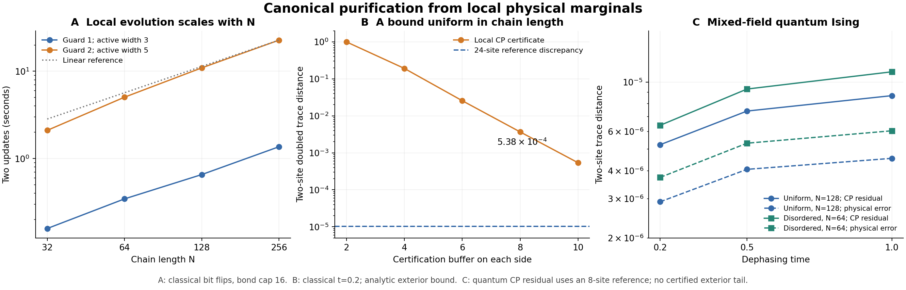

# Local canonical-purification evolution: large chains and endpoint certification

This study implements a local circuit update, reaches 256 classical and 128 quantum sites, and obtains a useful, size-independent certificate for a solvable noisy Ising model. The generic quantum algorithm is supported by convergence tests and a conditional certification formula. A quantitative exterior-CMI bound along the quantum noisy trajectory remains necessary for a rigorous quantum certificate.

All distances below are **local** unless explicitly identified as global. Write
\(D(a,b)=\frac12\|a-b\|_1\). The CP diagnostic compares reduced states on two physical sites **and their two reference partners**. It is more sensitive to purification gauge than the physical two-site density alone, but does not certify the global CP vector or every long-range observable.



## 1. The implemented algorithm and its objective

Let the physical channel act on a block \(S\) of \(\ell\) sites. Add a guard of \(r\) sites on either side to obtain the active region \(A\), then a further training buffer of \(b\) sites per side to obtain \(R=A\cup B\). Obtain the physical marginal \(\rho_R\) and compute \(\sigma_R=\mathcal E_S(\rho_R)\). Both are small, normalized density matrices.

The optimization variable is a finite unitary on the doubled active region. The objective is
\[
\min_{U_A^\dagger U_A=1}
d_R(U_A)^2,
\qquad
d_R(U_A)=\left\|(U_A\otimes1)|\sqrt{\rho_R}\rangle
                       -|\sqrt{\sigma_R}\rangle\right\|_2.
\]
These roots are computed from **local physical data**, without receiving the global target CP. Flatten the two vectors into matrices \(L,T\), with doubled active sites as rows. Minimizing this cost is equivalent to maximizing \(\operatorname{Re}\operatorname{Tr}(U_A^\dagger TL^\dagger)\). Its polar/SVD solution avoids nonlinear Hamiltonian optimization. The code adds \(10^{-12}1\) to favor the identity on poorly determined directions and reports the residual against the original cost.

The gate is stored as \(U=1+Q(V-1)Q^\dagger\), where the columns of \(Q\) span the columns of \(L,T\). Its retained rank is at most \(2\,4^{|B|}\), rather than necessarily \(4^{|A|}\). For a five-site active region and one training site on either side, this is at most 32. Apply this compact gate to the MPS, split by SVD with bond cap \(\chi\), and normalize at the current orthogonality center. This also fixes an unnecessary traversal to the first site after every gate.

This overlap trace is different from maximizing the trace of the global amplitude subject to an approximate density constraint. The latter allowed CP drift in the earlier small-chain experiment. Unitarity here preserves the doubled-state norm; it **does not guarantee that the reshaped amplitude remains positive semidefinite**. The physical density is positive by the purification representation, and closeness to the canonical gauge is checked separately.

### Scheduling and physical data

For onsite noise, partition the noisy sites into blocks and color the active intervals with
\[
c=\left\lceil\frac{\ell+2r}{\ell}\right\rceil
\]
colors. Supports within each color are disjoint. Every gate in one layer uses the same physical snapshot; then all affected physical marginal caches are updated. A site-to-cache lookup avoids scanning all windows for every physical update. The circuit has \(c\) layers per step, independent of chain length. With \(\ell=1,r=2\), there are five layers. Taking \(\ell\) proportional to \(r\) can keep this count bounded even when enlarging the guard.

Onsite channels make the physical marginal evolution closed and exact, given the initial marginals: channels outside a window disappear under the partial trace. The generic quantum runs initialize those marginals by contracting a prepared Gibbs CP MPS. The finite-range channel test instead obtains them from exact backward causal cones. Thus the update rule is local; the availability and accuracy of the physical marginal provider are separate inputs.

For full-rank smooth data, differentiating the local objective gives a possible Hamiltonian/TDVP target:
\[
S_R\dot S_R+\dot S_R S_R=\dot\rho_R,
\qquad
\min_{H_A=H_A^\dagger}\|-iH_A|S_R\rangle-|\dot S_R\rangle\|_2^2.
\]
The present experiments use the finite-step fit, not this tangent solver. Finite steps also accommodate rank-opening square-root behavior without assuming a bounded instantaneous generator.

## 2. A certificate evaluated on the final compressed MPS

Choose a doubled probe \(C\bar C\), a physical surrounding buffer \(B\), and exterior \(E\). Define
\[
\gamma_C=\operatorname{Tr}_{BE\bar B\bar E}|\sqrt{\rho}\rangle\langle\sqrt{\rho}|,
\quad
\gamma_C^{(R)}=\operatorname{Tr}_{B\bar B}|\sqrt{\rho_{CB}}\rangle\langle\sqrt{\rho_{CB}}|.
\]
Let \(\widetilde\gamma_C\) be the corresponding marginal of the actual, compressed output MPS. The local-computability fidelity inequality, converted to trace distance, gives the following endpoint bound. The cited theorem supplies the comparison of the two exact CP marginals; the triangle inequality supplies the comparison with the numerical output. [Li, Firanko and Hsieh, Theorem 11, v2](https://arxiv.org/pdf/2605.00088)

\[
\boxed{D(\widetilde\gamma_C,\gamma_C)
\le D(\widetilde\gamma_C,\gamma_C^{(R)})
       +\sqrt{1-e^{-I(C:E\mid B)_\rho}}.}
\tag{1}
\]

CMI uses natural logarithms. Equation (1) includes the errors already present from gate approximation, accumulated evolution and MPS compression. It does not add a worst-case error for every gate in the chain. For any observable supported on the doubled probe with operator norm at most one, its expectation error is at most twice this bound.

If the supplied physical marginal \(\widehat\rho_R\) has a certified error \(\eta=\|\widehat\rho_R-\rho_R\|_1\), add \(\sqrt\eta\) to (1). Indeed, \(\|\sqrt{\widehat\rho_R}-\sqrt{\rho_R}\|_2^2\le\eta\); pure-state trace distance and partial trace then give the claimed correction. Here \(\eta\) is the **full** trace norm.

If a justified bound \(I(C:E\mid B)\le K_Ce^{-b/\xi}\) is available, the exterior correction is at most \(\sqrt{K_C}e^{-b/(2\xi)}\), independently of total chain length. Fitting a decay curve to finite-window data alone does not prove this uniform bound. Noise acting on the conditioning buffer can also increase CMI, so an initial-state bound cannot simply be carried through the entire trajectory by data processing.

### An explicit exterior bound for the classical benchmark

The input is a stationary segment of the classical Ising Markov chain with dimensionless coupling \(J=0.4\), field \(f=0.15\), and transition matrix obtained from
\(M_{ss'}=e^{Jss'+f(s+s')/2}\), \(s=\pm1\). Apply independent bit flips with probability \((1-e^{-t})/2\). The resulting distribution is a hidden Markov model.

Here is a conservative bound derived for this experiment. A positive Ising transition matrix has Hilbert projective diameter \(\Delta=4|J|\) and contraction coefficient \(\tau=\tanh|J|\). Emission matrices are diagonal and do not enlarge projective distance; zero emission probabilities follow by a limiting argument. Consequently, after a buffer of \(b\ge1\) observations, the influence of arbitrary exterior messages on either side has projective diameter at most \(\Delta\tau^{b-1}\). This uses the positive-matrix contraction theorem. [Bushell, *On the Projective Contraction Ratio for Positive Linear Mappings*](https://doi.org/10.1112/jlms/s2-6.2.256)

Multiplying the two boundary messages adds their projective oscillations. Summation over hidden variables and application of the central emissions cannot increase the resulting likelihood-ratio interval. Thus, conditional on the observed buffer, any two exterior conditions produce central conditional distributions with pointwise ratios between \(e^{-\delta_b}\) and \(e^{\delta_b}\), where
\[
\delta_b=8|J|\tau^{b-1}.
\]
The same ratio bound holds relative to their mixture over the exterior. Using \(D_{\mathrm{KL}}(p\|q)\le\chi^2(p\|q)\) gives
\[
I(C:E\mid B)\le(e^{\delta_b}-1)^2,
\qquad
\sqrt{1-e^{-I}}\le\min\{1,e^{\delta_b}-1\}.
\tag{2}
\]
This is uniform in chain length, exterior observations and bit-flip time. At \(b=10\), the correction is \(5.2819224\times10^{-4}\). The local reference uses a 22-site **probability vector**, so the check avoids a dense 22-qubit density matrix. Equations (1)–(2) are analytic bounds; their numerical evaluations here use ordinary floating-point arithmetic, not interval enclosures.

## 3. Numerical evidence and the choices it supports

### Classical noise: 256 sites and a useful certificate

With \(r=2,b=1,\chi=16\), two steps of duration 0.1 give a two-site doubled discrepancy of \(1.01868\times10^{-5}\) from the independently evaluated 24-site CP reference. The value agrees across \(N=32,64,128,256\) at the same schedule phase. Applying (1) with the 22-site reference gives a **certified bound of \(5.38379\times10^{-4}\)** for the true CP marginal of each finite chain. The bound also controls the limiting local observable along the convergent bulk sequence.

The 24-site reference is a convergence diagnostic, not an exact global CP of the 256-site chain. Increasing its size from 20 to 24 changes the reference by \(4.1\times10^{-15}\) at \(t=0.2\), and \(1.0\times10^{-12}\) at \(t=0.5\). The certificate uses the analytic tail rather than assuming this observed convergence proves exactness.

The measured update times at active width five are 2.11, 5.05, 10.94 and 22.71 seconds for \(N=32,64,128,256\). These are one timing run with one BLAS thread, excluding initialization and certification. At active width three they are 0.158, 0.346, 0.656 and 1.367 seconds. These support approximately linear work in chain length at fixed window and bond cap.

At \(N=64,t=0.5\), increasing the guard from one to two lowers the reference discrepancy from \(2.95\times10^{-3}\) to \(1.11\times10^{-4}\). Increasing \(\chi\) from 16 to 32 leaves that latter error essentially unchanged. Increasing the training buffer from one to two gives \(1.14\times10^{-4}\) and costs much more. The active support is the limiting parameter in this test; a larger training buffer alone does not resolve that limitation.

Coloring introduces schedule-phase dependence. For \(r=2,t=0.5\), the largest error over the five bulk phases is \(1.28\times10^{-4}\), versus \(1.11\times10^{-4}\) at the reported phase. Phase-aligned size comparisons and the phase spread are recorded in the CSV files.

### Quantum Ising: uniform and disordered nonintegrable inputs

The uniform Hamiltonian is
\[
H=-\sum_j Z_jZ_{j+1}-1.05\sum_j X_j-0.35\sum_j Z_j,
\qquad \beta=0.8.
\]
The disordered case independently varies the couplings by \(\pm0.15\), transverse fields by \(\pm0.2\), and longitudinal fields by \(\pm0.2\), with seed 20261103. Apply onsite \(Z\) dephasing in ten steps of duration 0.1. Use \(r=2,b=1,\chi=24\) and fourth-order Gibbs preparation.

| Case at \(t=1\) | Physical two-site error | Doubled two-site CP residual, 8-site reference |
|---|---:|---:|
| Uniform, \(N=64\) | \(4.55\times10^{-6}\) | \(8.69\times10^{-6}\) |
| Uniform, \(N=128\) | \(4.55\times10^{-6}\) | \(8.69\times10^{-6}\) |
| Disordered, \(N=64\) | \(6.05\times10^{-6}\) | \(1.11\times10^{-5}\) |

The uniform 64- and 128-site diagnostics differ by less than \(10^{-12}\). Maximum discarded squared singular weight per split is around \(10^{-12}\). Neither number supplies an exterior-CMI bound. **The quantum CP column is a finite-window residual, not a certified error to the global CP.** Physical errors are relative to exact onsite evolution of the prepared initial marginals; preparation error is assessed separately.

### Initialization was an identifiable error source

In the integrable transverse-field control, a separate Majorana covariance calculation supplies exact Gibbs two-site marginals. It agrees with dense four-site diagonalization within \(10^{-12}\), and its 64- versus 256-site bulk difference is \(3.2\times10^{-16}\). Constructing reduced Gaussian states from correlations follows the standard method. [Peschel, *Calculation of reduced density matrices from correlation functions*](https://arxiv.org/abs/cond-mat/0212631)

Second-order imaginary-time preparation gives errors \(1.73\times10^{-4},4.33\times10^{-5},1.08\times10^{-5}\) at steps \(0.025,0.0125,0.00625\). These are large enough to conceal the evolution errors above. Replacing it with the symmetric fourth-order composition, with coefficients \(p,1-2p,p\), \(p=(2-2^{1/3})^{-1}\), gives \(3.00\times10^{-7}\) and \(1.87\times10^{-8}\) at steps 0.025 and 0.0125, consistent with fourth-order convergence. This is a direct numerical validation of the initialization change.

For the nonintegrable uniform input, the same step refinement changes the physical two-site initial marginal by \(4.40\times10^{-7}\). Repeating the complete evolution with both preparation steps changes the final doubled two-site output by \(5.39\times10^{-7}\) and the physical output by \(4.20\times10^{-7}\) at \(t=1\). These are below the observed evolution residuals. They are convergence evidence rather than exact-state error bounds; `refinement.csv` records the endpoint comparisons.

### Finite-range noise and finite time steps

A separate test starts from the full-rank product state \((1+0.45X+0.2Y+0.25Z)/2\), then applies pair loss \(|11\rangle\to|00\rangle\) on even and odd bonds, with jump probability \(1-e^{-0.2}\). Four CP layers suffice, with active width four and a one-site training buffer. On \(N=64\), the physical local error is \(3.00\times10^{-8}\), and the local CP residual against a six-site reference is \(1.40\times10^{-7}\). The largest physical oracle cone contains ten sites. At \(N=8\), an independent full density matrix verifies the physical oracle and gives actual local CP error \(6.63\times10^{-8}\) and global CP vector error \(7.66\times10^{-6}\). This tests genuinely interacting dissipative updates, but only one even/odd round.

Using a single onsite update for the whole interval \(t=1\) gives quantum physical error \(5.71\times10^{-6}\) and CP residual \(1.10\times10^{-5}\), close to the ten-step values above. At \(t=0.5\), the classical one-step discrepancy is \(2.36\times10^{-4}\), versus \(1.11\times10^{-4}\) for five smaller steps. Finite steps are practical, with model-dependent accuracy; small time steps are not a universal cure for insufficient spatial support.

Grouping two or three noisy sites reduces the update to two colors with a one-site guard. However, at \(t=0.5\), the quantum CP residuals are \(3.26\times10^{-4}\) and \(1.84\times10^{-4}\), considerably larger than \(7.42\times10^{-6}\) with one noisy site and a two-site guard. Fewer layers are useful only when the guard still resolves the local lifting.

## 4. What can be claimed about efficiency

For fixed active support, training buffer, certification window, bond cap and number of steps, construction, application and local certification have work and storage linear in \(N\). The underlying uncompressed circuit is manifestly local. The dense local square roots scale exponentially with physical window width; compact gates reduce storage/application costs without removing that dependence. SVD compression is a numerical approximation to this circuit and is covered by endpoint checks, rather than being assumed strictly local as a physical operation.

A conditional route to stronger complexity guarantees is available. Assume an efficient initial CP and physical marginal provider, quantitative Markov bounds uniform along the trajectory with controlled dependence on region size, and a fixed number of physical circuit layers. Logarithmic guard and buffer growth can make local lifting errors small. Blocking the noisy sites in proportion to the guard keeps CP layer count bounded. The exact circuit then has a bond bound of the form \(\chi_0 d^{O(aD)}\), where \(a\) is active width and \(D\) is total CP depth. For fixed depth and correlation parameters this can be polynomial in inverse accuracy, and in \(N\) if demanding a global accumulated-error budget. The exponent can grow with depth and Markov length. This is a conditional argument, not a general long-time polynomial guarantee.

The classical endpoint certificate is already practical and uniform in system size. Generic quantum certification still requires a justified exterior bound and accurate local physical data. For interacting noise, exact backward cones grow with physical depth, so the oracle used here does not settle long-time efficiency. A separately controlled MPDO solver or recovery approximation is a natural replacement, with its marginal error entering (1) explicitly.

The supported working choice is therefore: **buffered finite-unitary proposals, MPS compression, and endpoint tests on doubled local marginals**. Enlarge the active guard when its attainable residual dominates; enlarge the training or certification buffer when exterior uncertainty dominates; increase the bond cap only when compression checks indicate it matters. This gives an implementable algorithm and an interpretable error budget, while keeping the remaining quantum certification and long-time representability questions explicit.

## Reproduction and data

Use Python with NumPy, SciPy and Matplotlib. The tested NumPy/SciPy versions were 2.1.2/1.16.2; scripts set BLAS threads to one. From this directory:

```text
python local_cp_large.py --part sanity --outdir rerun
python local_cp_large.py --part scaling --outdir rerun
python local_cp_large.py --part precise --outdir rerun
python local_cp_large.py --part interacting --outdir rerun
python refine_large.py --outdir rerun
python plot_local_cp.py
```

Other `--part` choices are `classical`, `quantum`, `initialization`, `blocks`, `jump`, and `all`. Some dense local/reference checks are much more costly than the evolution itself. The largest classical reference uses \(2^{24}\) probabilities; the benchmark performs no global quantum density calculation at large \(N\).

`results/scaling.csv` contains the final indexed-cache timing run; `classical.csv` contains support, buffer, bond and schedule-phase controls. `precise_quantum.csv` contains the fourth-order uniform/disordered runs. `quantum.csv` and `block_updates.csv` retain second-order preparation controls, explicitly distinguished from the principal quantum results. `initialization.csv`, `refinement.csv`, `interacting_noise.csv`, `finite_jump.csv`, and `sanity.csv` contain their named checks. In per-step rows, `max_discarded` and `sum_sqrt_discarded` describe the recorded sweep, not the entire previous history. Dependencies from the earlier small-chain study are bundled so reproduction does not depend on the original workspace.
