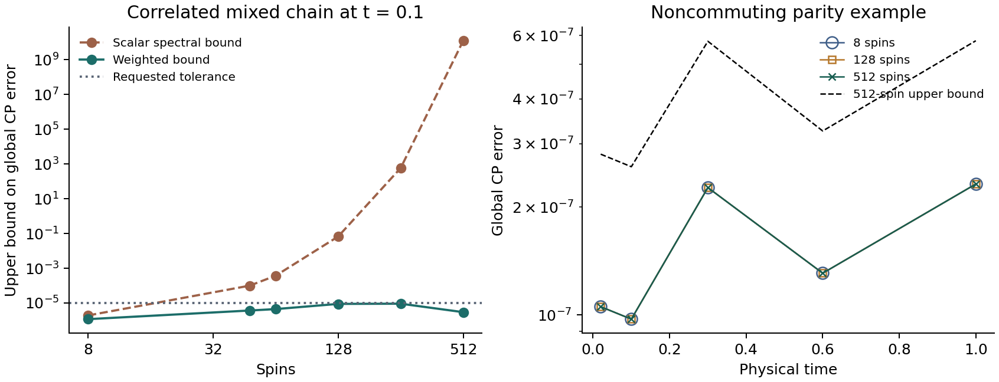

# Scaling canonical-purification TDVP with a positive witness

A two-site TDVP predictor with a checked endpoint correction reached 512 spins under uniform onsite dephasing. At $t=0.1$ the global canonical-purification (CP) error was bounded by $2.97\times10^{-6}$, with stored CP bond 8 and witness bond 6. A second 512-spin example has an analytic time-dependent root and long-range conditional mutual information. Its measured error at $t=1$ was $2.32\times10^{-7}$.

## What fixed the earlier failure?

The earlier acceptance test tried to prove that the smallest eigenvalue of the entire proposed root was positive. At 48 spins it stopped after $t=0.0025$. At 64 spins it could not accept even $t=0.000625$. The replacement controls **the size of the negative part** and **the error in the squared root** separately. Both contribute to the error of the stored state.

We replayed the old endpoint corrections on their saved inputs. At 64 spins, the old test again reported an unresolved positive branch on all four corrections. On the first proposal the new fit found a positive MPO within $9.42\times10^{-8}$, but the total error bound was still $1.01\times10^{-4}$. All four replayed bounds exceeded the requested $10^{-5}$. The successful trajectory used the new correction to improve the candidate as well. [48-spin replay](replay_n48.csv) · [64-spin replay](replay_n64.csv)

## An endpoint certificate for a stored MPO

Let $X$ be the Hermitian stored amplitude, $S=\sqrt{\rho}$ the desired positive root and $G$ an auxiliary MPO. Measure $\eta=\|X-GG^\dagger\|_F$. The factor $G$ is a witness for the **root**. The physical density used to check the evolution is propagated independently. Positive factorizations of physical density matrices are also used in locally purified tensor networks. [Werner et al., 2016](https://arxiv.org/abs/1412.5746)

For full-rank $\rho$, suppose a positive MPO $M$ satisfies $M\succeq\rho^{-1}$. With $E=X^2-\rho$, the global CP error obeys

$$
\|X-S\|_F \le 2\eta+\sqrt{\mathrm{Tr}(E^\dagger E M)}.
$$

The negative part of $X$ has Frobenius norm at most $\eta$, since $GG^\dagger$ is positive. In the left eigenbasis of $|X|$ and the right eigenbasis of $S$, each entry of $E$ equals $(|x_i|+s_j)(|X|-S)_{ij}$. Dividing by $s_j$ gives the weighted bound above. Hermitian rounding of a general input costs an additional measured distance. If the physical reference has trace-norm error $\delta$, the linear bound pays at most $\delta\sqrt{\|M\|_{\rm op}}$ in addition. The function `certify_candidate` accepts these inputs directly.

For $\rho=\Phi(\rho_0)$, take $D=\Phi(I)$ and $M=D^{-1}\Phi(\rho_0^{-1})D^{-1}$ when both inverses exist. Applying the completely positive map to the blocks of the positive matrix with diagonal blocks $\rho_0,\rho_0^{-1}$ and off-diagonal blocks $I$ gives the result by a Schur complement. For unital noise $D=I$. For independent amplitude damping $D$ is a product MPO. This construction can also start from a proven upper bound on $\rho_0^{-1}$. Its cost depends on how well the physical density and inverse bound can be represented. [Jensen's operator inequality](https://www.cambridge.org/core/journals/bulletin-of-the-london-mathematical-society/article/abs/jensens-operator-inequality/CC237B9A589649BBA9A0E58B65CA13B8)

For an unknown or singular spectrum there is a weaker option. A trace-one full-rank auxiliary state $\tau$ gives $\|E\|_1\le\|E\tau^{-1/2}\|_F$. Combining this with the Powers–Størmer inequality permits $M\succeq\tau^{-1}$ and a square root of the weighted residual norm. A five-spin rank-opening check gave actual error $0.0200$ and bound $0.0566$. The large-chain results below use the full-rank linear bound. [Dense verification, including a wrong-sign root](dense_checks.csv)

## Time evolution

1. Store the current root $X$ as an MPS on paired spin–reference sites. Use two-site tangent projection and a retracted midpoint step with a provisional Sylvester force $XV+VX=\mathcal L(X^2)$. Precondition the force using an accessible reference root and correct its residual once. The endpoint check sets the accuracy.
2. Fit the previous $G$ to the predicted root. Compare the predicted CP bound with the bound obtained by warm-starting from the previous endpoint. Keep the better trial.
3. If necessary, update the factor using the independently computed density defect $\rho-X^2$. A trial direction is $\rho_{\rm ref}^{-3/8}(\rho-X^2)\rho_{\rm ref}^{-3/8}/4$, the inverse derivative of the fourth power for commuting variations at the reference. Use it as a proposal for noncommuting data. Form $GG^\dagger$, normalize, recompress to a Hermitian $X$, and measure the witness distance after compression.
4. Backtrack and increase the working, factor and state bonds when needed. Accept a time step only if the global bound meets the requested tolerance. With `--max-halvings`, a failed trial restores the last accepted tensors and retries at a smaller step. A budget failure returns exit code 2 with that checkpoint on disk.

The weighted residual is contracted by an MPO transfer sweep. If compressing the residual makes its worst-case error allowance large, the code contracts the untruncated residual instead. An independent verification constructs a Kraus purification of the metric and computes the weighted norm by a streaming QR sweep. Neither route diagonalizes the large spin chain. The bounds use ordinary floating point and exclude a rigorous roundoff allowance.

## Uniform dephasing on a correlated mixed chain

Start from a product of spins with polarization $0.12$ along $X$, apply nearest-neighbor controlled-phase gates of angle $0.35$, then apply Hadamards. All sites undergo $Z$ dephasing, with coherence factor $e^{-t}$. Powers of the initial density have exact bond-four MPOs from the preparation circuit. Only the physical density and inverse metric are propagated exactly at later times. All entries below use the TDVP predictor and a $10^{-5}$ tolerance at every accepted endpoint.

| Spins | CP error upper bound at $t=0.1$ | Stored CP bond | Factor bond |
|---:|---:|---:|---:|
| 8 | $1.18\times10^{-6}$ | 6 | 4 |
| 48 | $3.70\times10^{-6}$ | 6 | 4 |
| 64 | $4.47\times10^{-6}$ | 6 | 4 |
| 128 | $8.88\times10^{-6}$ | 6 | 4 |
| 256 | $9.12\times10^{-6}$ | 6 | 4 |
| 512 | $2.97\times10^{-6}$ | 8 | 6 |

At eight spins, direct diagonalization gave $5.60\times10^{-7}$ at $t=0.1$. At 512 spins, the original contraction gave $2.97180306\times10^{-6}$ and the independent QR audit gave $2.97180314\times10^{-6}$. The four positive endpoints were $0.005,0.02,0.05,0.1$. Two runs took about 87 and 95 seconds on the test machine. With TDVP disabled, factor correction alone reached $0.1$ with bound $6.76\times10^{-6}$ in about 56 seconds in the recorded run. At 128 spins the TDVP trajectory also reached $t=0.3$ with bound $3.82\times10^{-6}$. Timings depend on the grid, tolerance and concurrent workload. [512-spin TDVP trajectory](n512_t0.1_s4_p0.12_a0.35_jensen_tdvp.csv) · [Independent verification](n512_t0.1_s4_p0.12_a0.35_jensen_tdvp_verification.csv) · [Factor-only control](n512_t0.1_s4_p0.12_a0.35_jensen.csv)



## A finite-chain family with long-range conditional mutual information

Consider the full-rank ensemble

$$
\rho(t)=2^{-N}\big[I+0.6 Z_1\cdots Z_N+b(t)X_1\big],\qquad b(t)=0.4e^{-t}.
$$

Uniform onsite $Z$ dephasing preserves the parity term. Since the two Pauli terms anticommute, densities at different times generally do not commute. The root is obtained analytically by taking the square roots of $2^{-N}(1\pm r)$ with $r=\sqrt{0.6^2+b^2}$ in the two spectral sectors. Only initial powers enter the solver. The analytic time-dependent root is used for scoring.

For a tripartition $ABC$ covering the chain, with site 1 in $A$ and each part nonempty, tracing out any site removes the parity term. Thus $I(A:C\mid B)=h((1+b)/2)-h((1+r)/2)$, where $h$ is binary entropy in nats. At $t=1$ it is $0.19445$ nats for every buffer width. This finite-chain family violates a uniform exponentially decaying Markov bound on those tripartitions. Its long-range information is a global parity bit, and its CP has a small bond.

At $N=8,128,512$, the five-step TDVP runs all met a $10^{-6}$ endpoint tolerance. At 512 spins and $t=1$, the **actual** global CP error was $2.31662\times10^{-7}$ and the bound was $5.80532\times10^{-7}$, with CP and factor bonds both 2. This example tests a global error that local marginals can miss. An interacting noisy critical chain presents a different representability and conditioning problem. [512-spin measured errors](n512_t1_s5_parity0.6_x0.4_jensen_tdvp.csv) · [QR verification](n512_t1_s5_parity0.6_x0.4_jensen_tdvp_verification.csv)

## Limits seen in stress tests

The nonunital amplitude-damping test used the same correlated preparation. At 64 spins the coarse grid stopped at $0.05$. Adaptive halving reached $0.1$ with bound $5.72\times10^{-6}$, CP bond 12 and factor bond 8. At 128 spins the three-halving run reached $0.06875$ and exhausted its budget on the next proposal. Increasing the starting bond and allowing four halvings also exhausted its budget. In the stronger dephasing preparation with polarization $0.35$ and angle $0.8$, a 64-spin cap sweep accepted $0.02$ but missed the target at $0.04$. A resolved branch still leaves an accuracy and conditioning problem for the dynamics. [64-spin damping](n64_t0.1_s4_p0.12_a0.35_jensen_tdvp_loss_adapt3.csv) · [128-spin damping](n128_t0.1_s4_p0.12_a0.35_jensen_tdvp_loss_adapt3.csv) · [Stronger preparation](n64_t0.1_s6_p0.35_a0.8_jensen.csv)

At fixed bonds and iteration count, the solver uses a number of tensor contractions linear in chain length. Each acceptance check sweeps the full finite chain. The examples do not establish size-independent bond requirements, an infinite-chain global certificate, a scalable generic rank-opening solver or a TDVP speed advantage. Scaling to noisy critical ground states still requires an affordable physical reference, a suitable metric or gap-free bound, and a way to represent the CP and its witness.

## Reproduce

Use the repository's NumPy and SciPy versions. The optional figure uses Matplotlib. From the directory containing this note, write new results to a separate directory with the following commands.

```sh
python code/validate_scalable_cp.py --out rerun
python code/validate_scalable_cp.py --replay 64 --out rerun
python code/scalable_cp_witness.py --n 512 --tdvp --times .005 .02 .05 .1 --out rerun
python code/scalable_cp_witness.py --n 512 --parity --tdvp --times .02 .1 .3 .6 1 --tol 1e-6 --levels 4,6,8:6,8,12 --passes 8 --out rerun
python code/scalable_cp_witness.py --n 64 --tdvp --noise loss --times .005 .02 .05 .1 --max-halvings 3 --out rerun
python code/validate_scalable_cp.py --checkpoint n512_t0.1_s4_p0.12_a0.35_jensen_tdvp_last_accepted.npz --out rerun
```
