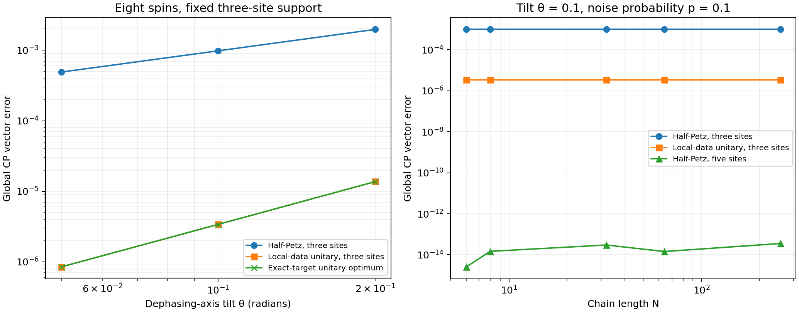

# Half-Petz and local-unitary fitting under tilted dephasing

For this single-update test, local-unitary fitting is substantially more accurate than the direct half-Petz map at fixed three-site support. Widening the half-Petz window to five sites restores numerical precision. The difference persists from six through 256 spins.

## State, channel and recovery promise

The input is the pure non-Clifford state V|+⟩⊗N on an open chain. Every nearest-neighbor bond of V is diag(1,1,1,exp(0.37i)). The constant bond angle keeps the bulk state identical across the size comparison. A single central spin receives

$$
\mathcal N_{p,\theta}(\rho)=(1-p)\rho+pP_\theta\rho P_\theta,\qquad
P_\theta=\cos\theta\,Z+\sin\theta\,X.
$$

We used p=0.1 and θ=0,0.05,0.1,0.2 radians on N=6,8,32,64,256. The active region contains either three or five physical sites and their reference partners.

At θ=0 a three-site recovery R₀ undresses the two incident controlled-phase gates, resets the central spin to |+⟩, and redresses the gates. At nonzero tilt,

$$
\|R_0\mathcal N_{p,\theta}(\rho)-\rho\|_1
\le p\,\|P_\theta\rho P_\theta-Z\rho Z\|_1
\le4p|\sin(\theta/2)|.
$$

This follows from trace-norm contractivity of R₀ and the operator norm of Pθ−Z. The bound quantifies approximate reversibility within three sites. On eight spins the actual full trace-norm recovery errors are 0.00238, 0.00475 and 0.00932 for the three nonzero tilts, below the respective bounds 0.0100, 0.0200 and 0.0399.

A five-site recovery is exact for every tested tilt. Undo the four controlled-phase gates inside that window. The transformed noise acts only on the three central spins, which were product states before the noise. Reset those three spins and reapply the gates. Correlations between the two outer spins and the exterior are preserved.

## Three constructions

**Direct half-Petz.** We use the previously tested forward map, with local physical factors and supported inverses. Its input is the initial CP MPS and the known physical channel. Its state bond cap is 64 here, making spatial truncation negligible for the single block update. The output is scored without renormalization. A separate normalized error column checks the effect of norm loss.

**Exact-target unitary optimum.** On the same active region, maximize the overlap with the exact global target CP over all doubled-site unitaries. A Procrustes SVD solves this objective globally. Mixed MPS environments and a joint local support basis reduce its matrix dimension to 32 even for a five-site gate. This oracle measures the best attainable error for that support and uses the target CP during construction.

**Practical local-data unitary fit.** Construct physical marginals before and after the channel on a fitting region extending one further site on each side of the active region. Fit a unitary on the active sites between the two local canonical roots by a compact Procrustes solve, then apply it to the global input MPS. The active three-site gate uses five-site physical data. A five-site gate uses seven-site data, clipped at chain boundaries. The exact target is accessed only when scoring this fit.

## Global CP errors

The score is the raw global vector distance ‖Q−√ρ′‖F. At eight spins, with a three-site active region, we obtain

| Tilt θ | Half-Petz | Best possible unitary | Local-data unitary |
|---:|---:|---:|---:|
| 0 | 1.35×10⁻¹⁴ | 1.23×10⁻¹⁴ | within numerical precision |
| 0.05 | 4.904×10⁻⁴ | 8.470×10⁻⁷ | 8.473×10⁻⁷ |
| 0.10 | 9.822×10⁻⁴ | 3.3977×10⁻⁶ | 3.3989×10⁻⁶ |
| 0.20 | 1.9755×10⁻³ | 1.3746×10⁻⁵ | 1.3751×10⁻⁵ |

At θ=0.1 the local-data fit reduces error by about 289 times relative to half-Petz at the same active support. Across the three nonzero angles, log-log slopes are 1.005 for half-Petz and 2.010 for both unitary constructions. These are empirical scalings in this family.

The raw half-Petz norm differs from one by at most 3.8×10⁻¹⁵ across all tested cases. Normalizing the output leaves the comparison unchanged at the quoted precision.

With a five-site active region, half-Petz, the unitary oracle and the practical fit all achieve errors below 2×10⁻¹³ for every tested size and tilt. The larger support contains the exact recovery in this example.

## Larger chains and validation

At θ=0.1 and three-site support, the half-Petz error is 9.82213518×10⁻⁴ on every tested chain. Its maximum difference from the eight-spin value is 1.1×10⁻¹⁵. The oracle optimum is 3.39771851×10⁻⁶ with size differences below 9×10⁻¹⁷. The local-data fit gives 3.39894998×10⁻⁶ on N=8,32,64,256. At N=6 its fitting window touches the boundary and gives 3.40536416×10⁻⁶.

We also compute the mutual-information loss I(E:W)ρ−I(E:W)ρ′ across the recovery window. At three-site support it is 5.94×10⁻⁷, 2.38×10⁻⁶ and 9.64×10⁻⁶ nats for the three nonzero tilts. On five sites it vanishes to roundoff. Thus the observed three-site errors concern controlled approximate reversibility.

The exact global reference is available at all these sizes. The two Kraus-factor columns are Z=[√(1−p)|ψ⟩,√p Pθ|ψ⟩]. Their Gram matrix G=Z†Z is 2×2, and √ρ′=ZG⁻¹ᐟ²Z†. This expression becomes a one-site linear filter on the initial CP MPS, so no dense whole-chain root is required. This special pure-input reference also shows that the benchmark isolates the two specified local-lift constructions. Repeated noise on many sites requires a separate mixed-state comparison.

At six and eight spins, independent dense Kraus-factor SVDs validate the MPS reference with maximum error 4.2×10⁻¹⁵. Independent dense three-site Procrustes calculations agree with the compact oracle. The code checks trace preservation, normalized unitary outputs, the oracle error lower bound, the exact-recovery controls and the explicit recovery-error bound.

Timings are saved as separate setup and update fields. The oracle receives the target CP, and the practical fit uses a larger physical-data window than half-Petz. The recorded timings therefore do not establish a general wall-clock advantage.

## Reproduce

The archive includes the comparison code, the imported half-Petz engine, raw CSVs, figure and checksum manifest. From the extracted directory,

~~~sh
python -m pip install -r requirements.txt
python compare_tilted_half_petz.py --n 6 8 32 64 256
python summarize_tilted_half_petz.py
~~~

The default output directory is tilted_half_petz_results. Every row records the support, fitting width, probability, tilt, raw and normalized CP errors, recovery bound, information loss, truncation and timing components.
